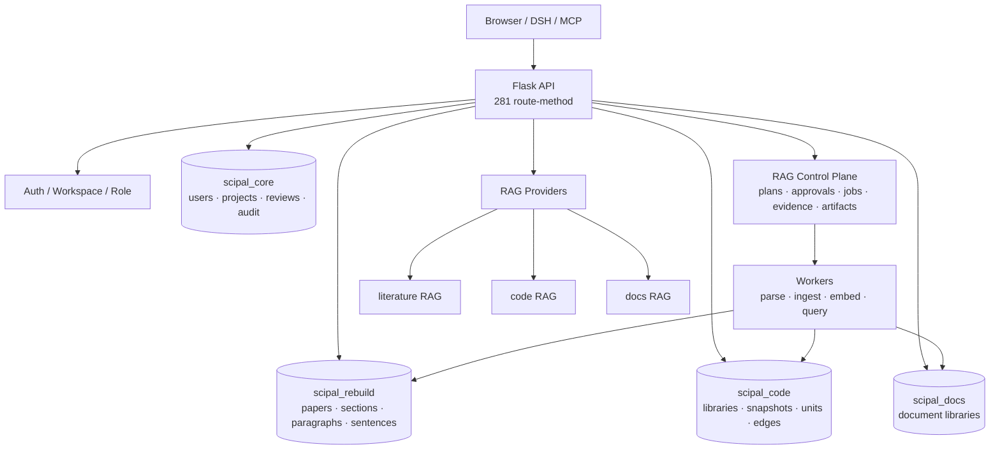
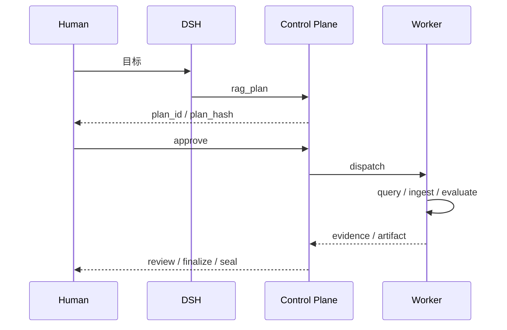

# SciPal

> 本地可部署的科研 RAG 工作台：文献、代码、证据链、综述与控制面。  
> 项目状态：**【 tenant-ready 单租户架构】**；Phase 2 多租户控制面冻结。  
> 不用于临床或受监管决策。

---

## 1. 今天完成了什么（2026-11-13）

```text
PDF 获取与解析
HTML/JATS 优先的获取设计
章-节-句树
sentence FTS
embedding 输入审计
paper reader API
scipal-paper MCP server（9 tools）
```

当前真实数据：

```text
HCC LAM 论文
  paragraphs   112
  sentences    800
  embeddings   106
  orphan       0
```

HCC 基因组论文：

```text
HTML         720 KB
R 文件       6
License      GPL-3.0-or-later
```

---

## 2. 系统定位

SciPal 不是“一个聊天框 + 一个向量库”。

它是：

```text
检索层
  + 证据层
  + 代码层
  + 控制面
  + 人工裁决
  + 可追溯导出
```

核心原则：

```text
机器负责召回与建议
人负责批准与最终判断
```

```text
不做：
  把 null 变成 0
  把 compile 当 Pass@1
  把 C3 当 C1
  跨 RAG 合并分数
  LLM 会议式投票
  自动吞下整个领域
```

---

## 3. 架构总览



### 数据库边界

```text
scipal_core     业务 / 用户 / 项目 / 审计
scipal_rebuild  论文 / 段落 / 句子 / embedding
scipal_code     代码库 / snapshot / code units
scipal_docs     文档 RAG
```

原则：

```text
物理分库
无跨库外键
逻辑 ID 关联
读路径不跨库写
写路径按 DSN 最小权限
```

---

## 4. 文献树：章 → 节 → 段 → 句

```text
paper
  └── section_level1
        └── section_level2
              └── paragraph
                    └── sentence
```

稳定 ID：

```text
paper_id
section_id
para_id       = paper_id + section + sequence
sentence_id   = para_id + _sent_NNN
```

索引分工：

```text
paragraph vector     语义召回
sentence inverted    句级证据 / FTS
section              导航 / 引用 / 权限，不单独建向量
```

查询链：

```text
query
  -> paragraph vector recall
  -> sentence FTS
  -> rerank
  -> evidence: sentence_id + para_id + section_path
```

> 不把 section/paragraph/sentence 编号拼进 embedding 文本。  
> embedding 前必须经过 `index_skip_reason`。

---

## 5. 单篇论文分析

`scipal-paper` 的设计目标：

```text
outline
  -> paragraph
  -> sentence
  -> evidence
  -> code links
  -> module map
  -> data flow
  -> replication plan
```

当前可用：

```text
GET /api/papers/<paper_id>/outline
GET /api/papers/<paper_id>/paragraphs
GET /api/papers/<paper_id>/paragraphs/first
GET /api/papers/<paper_id>/paragraphs/<para_id>/sentences
```

当前状态：

```text
reader service       PASS
HTTP routes          PASS（281 route-method）
outline 归一化       PASS（服务层）
scipal-paper MCP    9 tools（待 DSH 重启）
```

---

## 6. 代码 RAG

```text
repo
  -> library_id
  -> snapshot / commit
  -> file
  -> unit / function / class
  -> import / call / edge
```

能力：

```text
code_search
code_context
code_trace
per-library / per-commit
evidence / artifact
```

解析器现状：

```text
Python      支持
Nextflow    支持
R v1        支持（file/function/library/source）
Rmd/Quarto v1 chunk
混合仓库    v1 auto detect
跨语言调用  v1 低置信边
```

所以：

```text
不能声称“生信代码都能入库”
```

设计已明确：

```text
Language Provider
  detect
  parse
  resolve edges
  fixtures
```

---

## 7. 路由总览

`ARCHITECTURE.json` 是机器可读契约。当前校验：

```text
json_routes=281
app_routes=281
OK
```

主要路由组：

| 组 | endpoints | 作用 |
|---|---:|---|
| `rag_control` | 41 | RAG 控制面、plan、job、evidence、finalization、seal |
| `review_projects` | 26 | 系统综述、筛选、PRISMA、证据 |
| `papers_actions` | 35 | 本地 PDF、解析、附件、reader |
| `imports` | 8 | 导入会话 + 上传 + 队列 + 本地路径 |
| `protocols` | 14 | 实验协议 |
| `watch` | 14 | 文献监控 |
| `data` | 12 | 数据沙箱 / profile |
| `experiments` | 12 | 实验与运行 |
| `tenancy` | 9 | workspace / role |
| `claims` | 9 | claim cards |
| `review_actions` | 9 | 综述动作 |
| `search` | 6 | 混合检索 |
| `ingest_tracking` | 6 | 入库跟踪 |
| `qa` | 5 | 问答 |
| `code_libraries` | 3 | 代码库 |
| 其他 | 60 | auth、libraries、notes、tasks、references 等 |

完整路由：

```text
ARCHITECTURE.json
docs/en/Architecture-and-Routes.md
```

---

## 8. RAG 控制面



规则：

```text
DSH 提案
人批准
控制面执行
证据落 artifacts
```

封存：

```text
content_hash
Ed25519 signature
public key directory
RO-Crate / canonical.json
verify-seal
```

明确不做：

```text
外部 TSA
```

时间戳仍标注：

```text
timestamp_source = local_clock
```

---

## 9. 多租户

```text
workspace
  -> library
  -> object
```

scope：

```text
private / main / both
```

规则：

```text
A 可查自己的私有库
A 可联合查主库
A 不能读 B
普通用户不能写主库
主库 curator/admin 才能写
```

所有入口必须带：

```text
workspace_id
scope
```

缓存/任务/evidence/export 都必须带租户上下文。

---

## 10. 快速开始

### Docker Compose

```bash
cp deploy/.env.example deploy/.env
# 设置 DSN、SCIPAL_SECRET_KEY、backup passphrase
docker compose -f deploy/docker-compose.yml up -d --build
curl http://127.0.0.1/api/health
```

### 本地开发

```bash
python -m venv venv
venv\Scripts\activate
pip install -r requirements.txt
python api_server.py
```

本地 app：

```text
http://127.0.0.1:5001
```

### 关键 DSN

```text
SCIPAL_CORE_DSN          -> scipal_core
SCIPAL_AUTH_DSN          -> scipal_core
SCIPAL_PG_DSN            -> scipal_core
SCIPAL_PG_CORPUS_DSN     -> scipal_rebuild（read）
SCIPAL_PG_MAIN_READ_DSN  -> scipal_rebuild（read）
SCIPAL_PG_OWNER_DSN      -> scipal_rebuild（write）
SCIPAL_PG_INGEST_DSN     -> scipal_rebuild（ingest）
```

本地启动时，所有 `host.docker.internal:5433` 要替换为 `127.0.0.1:5433`，否则会出现：

```text
198.18.1.238:5433 connection failed
```

---

## 11. 测试与校验

```bash
python -m unittest discover -s tests -p "test_*.py"
python scripts/validate_arch.py
python scripts/audit_embedding_inputs.py --paper-id <id>
```

当前相关测试：

```text
test_html_parser        3 passed
test_sentence_tree      3 passed
test_paper_reader       4 passed
```

架构：

```text
json_routes=281
app_routes=281
OK
```

---

## 12. 当前缺口

```text
R 深度 AST 未实现（v1 是保守扫描）
Rmd/Quarto chunk + 内部函数 v1
混合仓库 auto detect v1；跨语言低置信
HTML 尚未接入 corpus ingest
DSH 尚未重启加载 scipal-paper
sentence evidence 链未接
Results/Methods 有启发式 fallback（body_headings）
app 重启后需再验证 outline 归一化
全库低质量 embedding 只修了 HCC 一篇
```

---

## 13. 文档

| 文档 | 用途 |
|---|---|
| [设计-Paper-to-Code与主动科研工作流-v1](docs/设计-Paper-to-Code与主动科研工作流-v1.md) | 文献 → 代码 → 复刻总设计 |
| [设计-scipal-paper-单篇论文分析插件-v1](docs/设计-scipal-paper-单篇论文分析插件-v1.md) | 单篇论文插件设计 |
| [实验-Sentence-Tree](docs/实验-Sentence-Tree.md) | 句树入库 |
| [实验-Paper-Reader-API](docs/实验-Paper-Reader-API.md) | reader API |
| [实验-Embedding输入审计](docs/实验-Embedding输入审计.md) | 向量输入审计 |
| [实验-HTML解析器](docs/实验-HTML解析器.md) | HTML 解析 |
| [实验-Paper-Analysis](docs/实验-Paper-Analysis.md) | 单篇聚合入口 |
| [实验-Paper-Code-Links](docs/实验-Paper-Code-Links.md) | 论文代码链接 |
| [实验-Paper-Code-Bindings](docs/实验-Paper-Code-Bindings.md) | paper ↔ code library |
| [实验-Scipal-Paper-MCP](docs/实验-Scipal-Paper-MCP.md) | MCP 插件 |
| [实验-Replication-Plan](docs/实验-Replication-Plan.md) | 复刻计划 |
| [实验-证据质量修复](docs/实验-证据质量修复.md) | caption/首段/句内图注 |
| [实验-全库Caption审计](docs/实验-全库Caption审计.md) | 全库 caption 审计 |
| [实验-Results-Fallback](docs/实验-Results-Fallback.md) | Results 标题回退 |
| [实验-Section-Types](docs/实验-Section-Types.md) | outline section_type |
| [实验-Section-Type-覆盖](docs/实验-Section-Type-覆盖.md) | 覆盖率审计 |
| [实验-Paper-Sources](docs/实验-Paper-Sources.md) | 来源层 |
| [实验-JATS-Native](docs/实验-JATS-Native.md) | JATS 原生层 |
| [实验-HTML-Native](docs/实验-HTML-Native.md) | HTML 原生层 |
| [实验-PDF-Native](docs/实验-PDF-Native.md) | PDF 原生层 |
| [实验-Federation](docs/实验-Federation.md) | 论文联邦视图 |
| [讨论-租户独立建库与插件化导入管线](docs/讨论-租户独立建库与插件化导入管线.md) | 租户建库讨论 |
| [讨论-04-CodeRAG是否按语言建库](docs/讨论-04-CodeRAG是否按语言建库.md) | CodeRAG 分库边界 |
| [讨论-05-文献监控与自动入库](docs/讨论-05-文献监控与自动入库.md) | 监控触发入库 |
| [讨论-06-租户工作区隔离与星形联邦](docs/讨论-06-租户工作区隔离与星形联邦.md) | 租户隔离与联邦拓扑 |
| [租户联邦执行计划总表](docs/plans/tenant-federation/00-execution-plan.md) | E0–E8 执行状态 |
| [决策-单租户优先](docs/plans/tenant-federation/DECISION-single-tenant-first.md) | 暂停 E3–E8 |
| [架构-租户状态与Phase2Roadmap](docs/架构-租户状态与Phase2Roadmap.md) | 当前架构状态 |
| [单租户交付执行计划总表](docs/plans/single-tenant/00-execution-plan.md) | N0–N3 交付计划 |
| [N0 单租户导入管线](docs/plans/single-tenant/N0-import-pipeline.md) | 导入管线计划 |
| [方案-HTML-first 批量入库](docs/plans/single-tenant/H-html-batch.md) | H0–H4 方案 |
| [H0 HTML Batch CLI](docs/plans/single-tenant/H0-html-batch.md) | 批量 CLI 计划 |
| [H1 Nature/PMC Adapter](docs/plans/single-tenant/H1-nature-pmc-adapter.md) | HTML 适配器 |
| [H2 HTML 质量门禁](docs/plans/single-tenant/H2-html-quality-gate.md) | 质量门禁 |
| [H3 PDF fallback](docs/plans/single-tenant/H3-pdf-fallback.md) | PDF 回退 |
| [H4 Cell/JS adapter](docs/plans/single-tenant/H4-cell-js-adapter.md) | Cell 访问层 |
| [U0 前端批量上传](docs/plans/single-tenant/U0-upload-staging.md) | 上传 staging |
| [U1 Import Queue](docs/plans/single-tenant/U1-import-queue.md) | DB 队列 + worker |
| [U2 DSH 本地路径](docs/plans/single-tenant/U2-dsh-local-import.md) | DSH 路径导入 |
| [实验-HTML批量验收](docs/实验-HTML批量验收.md) | 综合验收 |
| [实验-N0-端到端](docs/实验-N0-端到端.md) | N0 端到端 |
| [实验-Paper-Section-API](docs/实验-Paper-Section-API.md) | 按类型取整节 |
| [实验-R-Parser-v1](docs/实验-R-Parser-v1.md) | R 解析与 ingest |
| [实验-Paper-Module-Map](docs/实验-Paper-Module-Map.md) | 模块视图 |
| [实验-Paper-Data-Flow](docs/实验-Paper-Data-Flow.md) | 数据流 |
| [实验-第二篇论文-端到端](docs/实验-第二篇论文-端到端.md) | 第二篇论文验证 |
| [实验-Paper-Plugin-Smoke](docs/实验-Paper-Plugin-Smoke.md) | 插件 smoke |
| [实验-Rmd-Mixed](docs/实验-Rmd-Mixed.md) | Rmd/混合仓库 |
| [实验-Cross-Language-Edges](docs/实验-Cross-Language-Edges.md) | 跨语言低置信边 |
| [Architecture JSON](ARCHITECTURE.json) | 机器可读路由契约 |
| [Documentation index](docs/README.md) | 全部文档 |

---

## 14. 仓库结构

```text
api_server.py          Flask 入口
routes/                路由 blueprints
services/              search / papers / rag_control / review / tenancy
build_db/              parser / JATS / PG writer
frontend/              HTML/CSS/JS
docs/                  设计、实验、迁移、操作
scripts/               smoke / audit / validate / backfill
tests/                 unittest
deploy/                Docker / compose / SQL
ARCHITECTURE.json      路由契约
```

---

## 15. 一句话

```text
论文不是一段文本
而是一棵可引用的树
代码不是一个 repo
而是一组可定位的模块
```

SciPal 的工作是：

```text
把树建好
把证据留住
把代码定位准
把最终判断留给人
```
