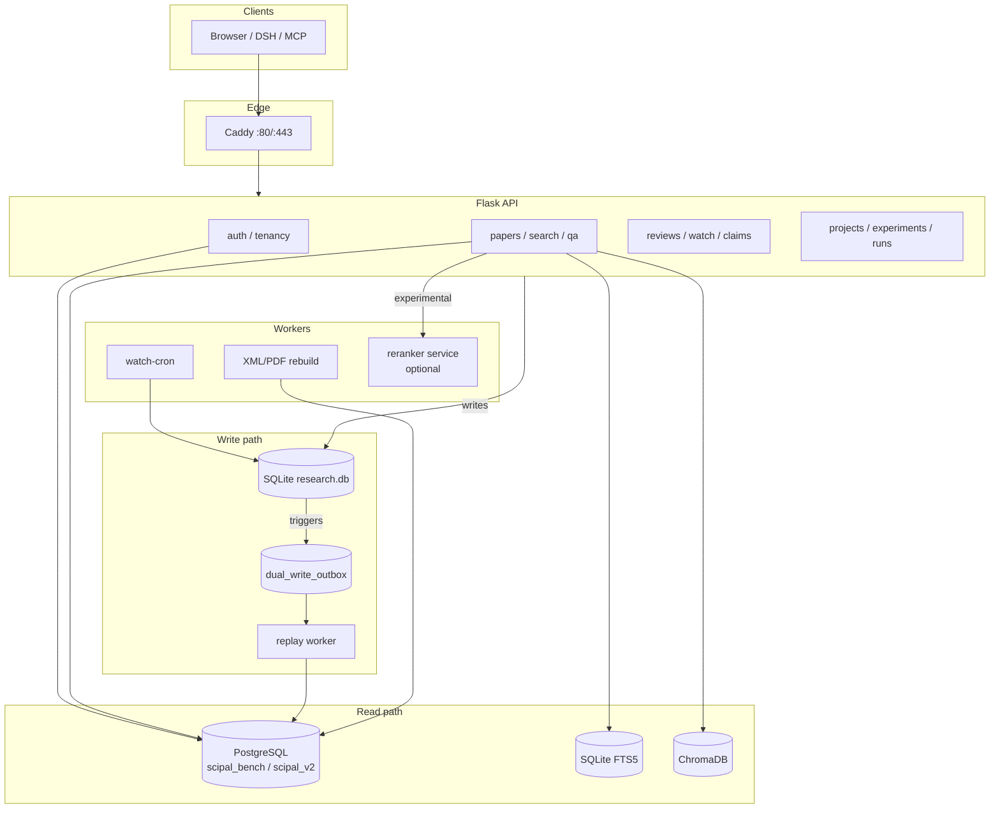

# Project Handover Guide

> **SciPal / Sci-Pal — engineering handover**  
> Last updated: 2026-11-01  
> Status: active development (WIP); no stable release.

This document is the first thing a new maintainer should read after `.dsh_rules`
and `README.md`. It replaces the old WorkBuddy / CodeBuddy handoff notes, which
are archived under [`archive_legacy/`](archive_legacy/README.md).

---

## 1. Environment and bootstrap

### 1.1 What changed

The data path is no longer a SQLite-only application. The current split is:

```text
Read paths for papers, paper detail, paper graph, and tenancy: PostgreSQL
Writes: SQLite primary + P4 dual-write outbox -> replay worker -> PostgreSQL
FTS / search: SQLite FTS5 + Chroma (sentence FTS in scipal_v2 is experimental)
Realtime routes: Flask; watch scheduling: watch-cron
```

Do not describe this as “everything is PostgreSQL.” The honest description is:

```text
PostgreSQL is the production read backend for the paper read paths.
SQLite is still the write primary and the FTS backend.
P4 dual-write keeps PostgreSQL in sync.
```

### 1.2 Requirements

```text
Python 3.12
Docker + Docker Compose
PostgreSQL 16 (external to the app container)
8–16 GB RAM for local parsing/model work
Optional GPU for local LLMs
```

The Python venv used by the project:

```text
venv_sciPal_py312
```

### 1.3 One-command application stack

From the repository root:

```bash
cp deploy/.env.example deploy/.env
# Edit deploy/.env: secrets, LLM, and SCIPAL_PG_DSN
docker compose -f deploy/docker-compose.yml up -d --build
```

What this starts:

```text
app          Flask API
watch-cron   scheduled literature monitoring
caddy        reverse proxy on 80/443
```

PostgreSQL is intentionally **not** baked into the app image. Point
`SCIPAL_PG_DSN` at the existing PostgreSQL instance. Example shape:

```text
SCIPAL_PG_DSN=postgresql://scipal:<password>@host.docker.internal:5433/scipal_bench
```

For a Linux host that needs `host.docker.internal`, add:

```yaml
extra_hosts:
  - "host.docker.internal:host-gateway"
```

Then verify:

```bash
curl -fsS http://127.0.0.1/api/health
docker compose -f deploy/docker-compose.yml ps
```

### 1.4 PostgreSQL and schema

The current production database is `scipal_bench` (read path) and the source-
aware rebuild target is `scipal_v2`.

```text
build_db/postgres_schema.sql       legacy 60-table schema
build_db/postgres_schema_v2.sql    source-aware v2 schema
scripts/create_pg_v2.py            create scipal_v2 (P1)
build_db/pg_v2_import_xml.py       XML rebuild (P2)
build_db/pg_v2_import_pdf.py       PDF rebuild (P3)
```

Never point a migration at the old SQLite file and expect it to be modified in
place. The SQLite database is the write source; PostgreSQL is the read/scale
target.

### 1.5 First login

```bash
docker compose -f deploy/docker-compose.yml exec app \
  python scripts/create_admin.py admin
```

Then open `/login.html`.

---

## 2. Architecture and routing topology

### 2.1 High-level topology



### 2.2 Read/write rules

```text
Reads:
  /api/papers              PostgreSQL
  /api/papers/<id>         PostgreSQL
  /api/papers/<id>/graph   PostgreSQL
  tenancy lookups           PostgreSQL
  FTS / vector retrieval    SQLite FTS5 + Chroma

Writes:
  API writes                SQLite
  SQLite triggers           dual_write_outbox
  replay worker             PostgreSQL upsert/delete
```

Do not add a direct PostgreSQL write from a route. The outbox is the consistency
boundary.

### 2.3 Parsing and rebuild workers

```text
XML: build_db/jats_parser.py -> pg_v2_import_xml.py
PDF: build_db/pg_v2_import_pdf.py -> PyMuPDF pages/blocks
```

Parsers are batch workers, not request-path services. Long parsing must not run
inside the Flask request thread.

### 2.4 Frontend routes

The frontend is vanilla HTML/CSS/JS under `frontend/`, served through Flask/Caddy:

```text
/login.html
/index.html
/review.html
/qa.html
/viewer.html
/trace.html
/projects.html
/reviews.html
/watch.html
/packs.html
/claims.html
```

---

## 3. Contracts and configuration isolation

### 3.1 JSON architecture contract

`ARCHITECTURE.json` is the machine-readable contract. It declares:

```text
schema_version
runtime
tech_stack
architecture.principles / layers / data_model / retrieval_flow
storage
api.blueprints / groups / endpoints
deployment
tests
limitations
benchmark_db
postgres_migration
```

`ARCHITECTURE.md` is the human-readable companion. When a public route, schema,
or deployment contract changes, update both or explicitly record why one is not
applicable.

Never commit generated machine-specific values (absolute paths, secrets, DSNs)
into either file.

### 3.2 The five project rules

The highest-priority rules live in [`.dsh_rules`](../.dsh_rules):

```text
1. One PR, one theme.
2. A human must explicitly say “merge”; CI passing is not permission.
3. Research decisions (claim/evidence/adjudication/writing brief) are separate
   from engineering changes and need human confirmation before writes.
4. After two consecutive negative results in the same direction, stop and
   discuss; do not keep tuning parameters.
5. Every round ends with: what was done, what evidence exists, what a human
   needs to decide.
```

### 3.3 Configuration layers

```text
.env / deploy/.env          runtime configuration; never commit
config/paths.py             portable path resolution
config/settings.py          legacy compatibility defaults
SCIPAL_* environment vars   the current public configuration surface
```

Key variables:

| Variable | Purpose |
|---|---|
| `SCIPAL_SECRET_KEY` | Flask session signing |
| `SCIPAL_LLM_*` | model provider, base URL, model, key |
| `SCIPAL_AUTH_REQUIRED` | require login |
| `SCIPAL_PG_DSN` | PostgreSQL read database |
| `SCIPAL_DB_BACKEND` | adapter opt-in (`sqlite` / `postgres`) |
| `SCIPAL_READ_CANARY_PERCENT` | paper read canary percentage |
| `SCIPAL_READ_DETAIL_PERCENT` | paper detail canary |
| `SCIPAL_READ_GRAPH_PERCENT` | paper graph canary |
| `SCIPAL_TENANCY_READ_BACKEND` | tenancy read backend |
| `SCIPAL_EMBEDDING_MODEL` / `SCIPAL_RERANK_MODEL` | local model paths |

Do not edit Python files to change a deployment endpoint. Use the environment
file and restart the affected service.

### 3.4 Extending a new format or domain

```text
New source format:
  add a parser under build_db/ (or build_db/parsers/)
  make it emit the same section/paragraph/sentence/figure/table contract
  keep page/bbox or XPath provenance; never fabricate coordinates

New domain:
  add a declarative pack under packs/<name>/pack.yaml
  include taxonomy, section types, evidence schema, and prompts
  do not fork the core retrieval code

New route:
  add a blueprint under routes/
  register it in api_server.py
  document it in ARCHITECTURE.json and docs/接口明细.md
```

---

## 4. Safety: cross-platform and SQLite limits

### 4.1 Path rules

Use `pathlib.Path`; never hardcode separators or machine roots:

```python
Path("data") / "research.db"      # correct
"data/research.db"                # not portable
"D:\\scipal\\data"                 # never commit
```

`scripts/check_portability.py` enforces the rule. Run it before a PR.

### 4.2 Windows vs Linux

```text
Windows development:
  venv_sciPal_py312\Scripts\python.exe
  entry scripts reconfigure stdout to UTF-8
  do not use Linux-only commands or fcntl/resource/pwd

Linux deployment:
  use the venv/bin/python path
  Docker volumes and file permissions matter
  data directories must be writable by the container user
```

### 4.3 Why SQLite must not run large/concurrent benchmarks

```text
SQLite is single-writer.
A 20-way concurrent request loop produced 500s under SQLite.
The P4/P5 work exists specifically to move read pressure to PostgreSQL.
```

Policy:

```text
>100 papers or concurrent workers  -> PostgreSQL required
<=100 papers, single process       -> SQLite only with
                                      SCIPAL_BENCH_ALLOW_SQLITE=1
```

Current production read paths are PostgreSQL; do not “test” them by pointing a
load generator at a SQLite-only local process.

### 4.4 Reranker deadlock lesson

PyTorch + Flask multithreading can deadlock. Keep reranking in a separate
process/service (`services/search/rerank_worker.py`,
`scripts/rerank_service.py`) and use a per-request timeout.

---

## 5. Known limitations and next steps

### 5.1 Current retrieval reality

```text
Paragraph FTS (SQLite FTS5 BM25) is the production paper-ranking baseline.
Sentence-level FTS in scipal_v2 is experimental.
The 65万-sentence table makes ts_rank sorting expensive.
```

Measured:

```text
20-query RRF loop: sentence FTS ~9.2s average
20-paragraph /score: ~0.25s
50-paragraph /score: ~0.31s
```

The bottleneck is candidate generation/sorting, not the cross-encoder.

### 5.2 Two-stage retrieval is not production-ready

Experiments showed:

```text
unranked LIMIT 200: 0.256s but Recall@10 = 0.00
ranked 5-term 200 + rerank: Recall@10 = 0.85
rank_cd 100 + rerank: 5-query sample reached 1.0, but sample was biased
```

Do not switch production until a 20-query, per-source evaluation holds
`Recall@10 >= 0.95` and warm latency stays under 1 second.

### 5.3 When to introduce Elasticsearch / Milvus

```text
Elasticsearch / OpenSearch:
  when BM25 tuning, analyzers, aggregations, or >10M documents matter

Milvus / Qdrant:
  when vector recall becomes the dominant workload; not a replacement for BM25

Vespa:
  when multi-phase ranking and online serving become a first-class requirement

Partitioning:
  defer until the sentence table is far beyond the current ~650k rows
```

### 5.4 Reading order for the next maintainer

```text
1. .dsh_rules
2. README.md
3. docs/en/Architecture-Overview.md
4. docs/en/Architecture-and-Routes.md
5. docs/数据重建-schema-v2-按源类型建模.md
6. docs/Research_Logs_Index.md
7. docs/en/plans/PostgreSQL-Migration.md
8. docs/检索优化-社区方案调研.md
```

### 5.5 Handover checklist

```text
[ ] can start the compose stack
[ ] /api/health returns 200
[ ] can log in and list papers
[ ] can explain SQLite write -> outbox -> PostgreSQL read
[ ] can run scripts/run_tests_guarded.py
[ ] can run scripts/check_portability.py
[ ] knows where the five rules are
[ ] knows the reranker/worker boundary
[ ] knows the 65万-sentence limitation
```

---

## 6. Legacy lessons worth keeping

From the archived V33.13 / WorkBuddy / CodeBuddy documents:

```text
Environment setup is the first failure mode.
  -> Docker compose is the supported path; do not rely on a personal venv story.

Two writers on one working tree create conflicts.
  -> one active writer, one theme per PR, explicit merge approval.

PyTorch + Flask multithreading can deadlock.
  -> isolate inference; use a bounded worker or HTTP service.

Hardcoded D:/G:/home paths break Linux.
  -> pathlib + config/paths.py + portability check.

SQLite under concurrent reads fails at exactly the wrong time.
  -> PostgreSQL for reads; P4 outbox for consistency.
```

Archive entry:

[archive_legacy/README.md](archive_legacy/README.md)
