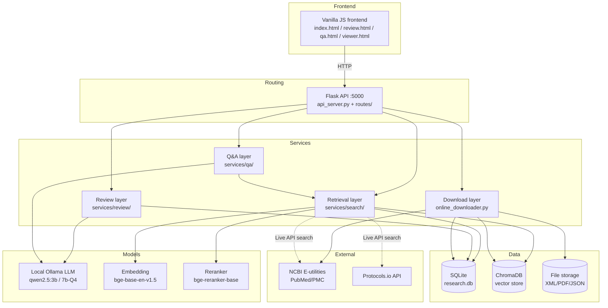
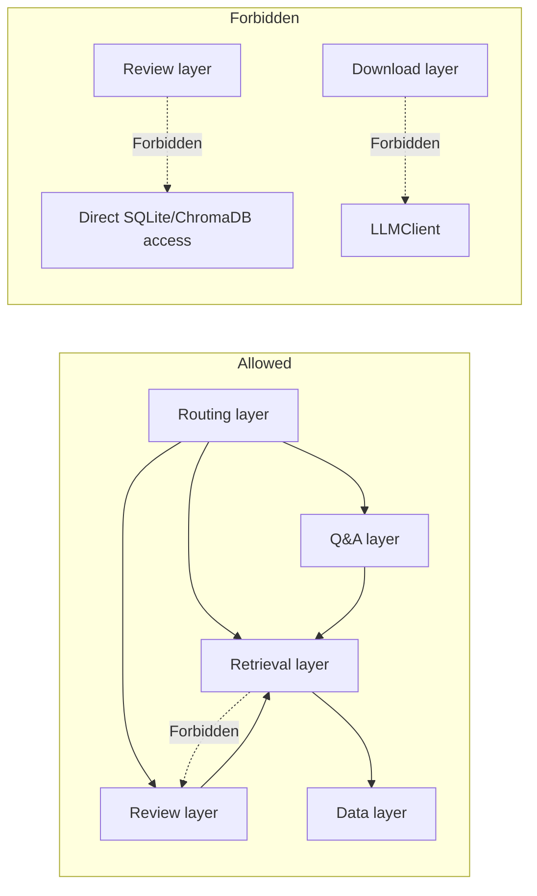

# Architecture Overview

> This document is the "god's-eye view" — look at the diagram first, then the module descriptions, and finally the API details.
> It is written for humans and for AI. Read this file before every new conversation.

## Environment Constraints (top-level design, non-negotiable)

- **Target system**: Windows 10/11, Python 3.12 (venv: `venv_sciPal_py312`)
- **Path handling**: always use `pathlib.Path`; never hardcode `/` or `\`
- **Do not use**: Linux commands such as `chmod`, `apt-get`, `kill`, `ps`, `grep`; Linux libraries such as `fcntl`, `resource`, `pwd`
- **Console encoding**: entry scripts must add `sys.stdout.reconfigure(encoding='utf-8')`
- **Database**: SQLite + ChromaDB (embedded) by default; PostgreSQL is optional for benchmarks and the v2 data rebuild
- **LLM**: local Ollama service at `http://localhost:11434`

## The Big Picture



> ⚠️ **Note**: this project runs on Windows, so path handling must stay cross-platform.
> Build every file path with `pathlib.Path`; never hardcode a separator.

## Module Responsibilities (one-liner version)

### Frontend layer
| Module | What it does |
|------|--------|
| `frontend/index.html` | Search home page: enter keywords, hybrid search across local + online papers |
| `frontend/review.html` | Review generation page: choose outline → assign papers → generate chapter by chapter |
| `frontend/qa.html` | Q&A page: RAG-based academic Q&A |
| `frontend/viewer.html` | PDF reader: view source text, annotate |

### Routing layer
| Module | What it does |
|------|--------|
| `api_server.py` | Main Flask entry point and the registration hub for all API routes |
| `routes/` | Route files split by business domain (search/paper/ai/writing) |

### Service layer
| Module | What it does | In one line |
|------|--------|--------|
| **Retrieval layer** `services/search/` | Find papers from many sources | Local vectors + FTS, NCBI online, Protocols.io methods |
| **Review layer** `services/review/` | Generate literature reviews | Retrieve evidence → LLM drafts → review → automatic citations |
| **Q&A layer** `services/qa/` | Answer questions | Retrieve relevant paragraphs → LLM generates an answer → parse citations |
| **Download layer** `online_downloader.py` | Download new papers asynchronously | Background thread downloads PMC XML → ingest → build index |

### Model layer
| Module | What it does |
|------|--------|
| `LLMClient` | Unified wrapper around Ollama calls; supports chat and chat_json |
| `Embedding` | Text to vectors (bge-base-en-v1.5) |
| `Reranker` | Cross-encoder reranking (bge-reranker-base) |

### Data layer
| Store | What it holds |
|------|--------|
| SQLite `data/research.db` | Paper metadata, sections, paragraphs, figures and tables, evidence cards |
| ChromaDB `data/chroma/` | Full-text paragraph vectors |
| ChromaDB `data/chroma_abstracts/` | Abstract vectors |
| Files `documents_xml/` | PMC full-text XML |

## Module Boundaries (lines that must never be crossed)



| Forbidden behavior | Reason |
|----------|------|
| Review layer writes to SQLite/ChromaDB directly | It must go through the retrieval layer so retrieval logic stays unified |
| Q&A layer uses EvidenceExtractor directly | Q&A has its own evidence chain; do not mix the two |
| Download layer calls LLMClient | Downloading only fetches data; it does no AI inference |
| Retrieval layer calls ReviewGenerator | Retrieval is the callee; it must not depend on the business layer in reverse |
| Any module reads or writes `data/*.db` directly | It must go through the DAO layer |
| Frontend talks to NCBI/Protocols.io directly | It must go through the backend proxy to protect API keys |

## Data Flow Overview

```
user input → routing layer → service layer (retrieval/review/Q&A) → data layer (SQLite+ChromaDB)
                          ↓
                    external services (NCBI/Protocols.io)
```

For function-by-function details, see [API Reference](API-Reference.md).
