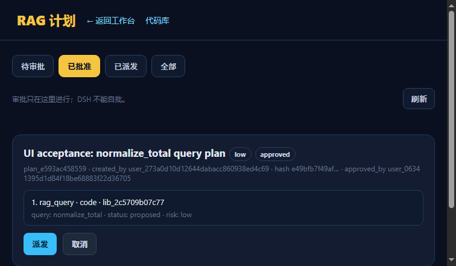
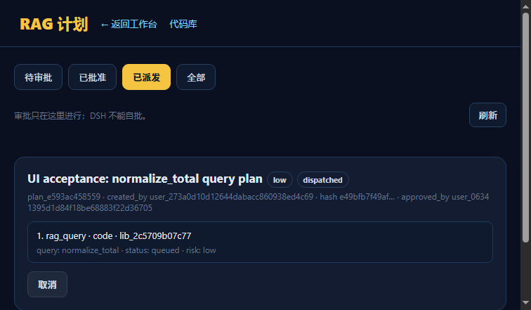

# 实验记录：RAG 计划审批 UI

> 日期：2026-11-13  
> 状态：**审批/派发 UI 可用；多 RAG 未接**  
> 页面：`/plans.html`

---

## 1. 功能

```text
列出 proposed / approved / dispatched
显示 plan steps
批准
派发
取消
```

审批只在此页面进行；DSH 的 `rag_plan` 不能自批。

## 2. API

```text
GET  /api/rag/plans?status=proposed
POST /api/rag/plans/<id>/approve
POST /api/rag/plans/<id>/dispatch
POST /api/rag/plans/<id>/cancel
```

## 3. 浏览器验收

流程：

```text
DSH rag_plan -> plan_e593ac458559 proposed
打开 /plans.html
点击批准 -> approved
点击派发 -> dispatched
step queued
```

截图：





## 4. 修复的 UX

批准后仍停在“待审批”，卡片消失，用户看不到派发按钮。

修复：

```text
批准后自动切到 approved 标签
派发后自动切到 dispatched 标签
```

同时给 step 增加 `approved` 状态，避免审批后 step 仍显示 `proposed`。

## 5. 验证

```text
tests.test_rag_plans 6 passed
validate_arch 234/234 OK
```

## 6. 边界

```text
只显示/审批计划
不创建计划（DSH 创建）
没有多 RAG 路由
worker 仍是独立进程
```

## 7. 下一步

```text
多 RAG 路由：literature / docs
```
