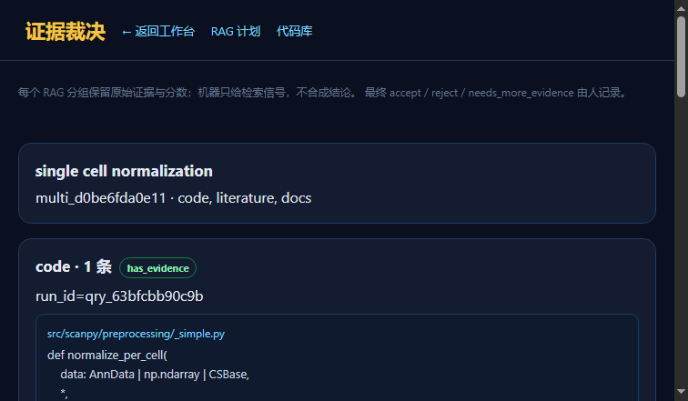

# 实验记录：R7 分组证据与人工裁决

> 日期：2026-11-13  
> 状态：**multi group UI + human adjudication 通过**  
> 页面：`/evidence.html`

---

## 1. 原则

```text
每个 RAG 分组保留原始证据与分数
机器只给 retrieval_signal
不合成唯一结论
最终裁决由人记录
```

机器信号：

```text
has_evidence
insufficient_evidence
error
```

它只表示“检索到了/没检索到”，不表示科学结论。

## 2. 数据

```text
rag_multi_queries
rag_multi_groups
rag_adjudications
```

一次 multi run：

```text
multi_d0be6fda0e11
```

三组：

```text
code        has_evidence
literature  has_evidence
docs        has_evidence
```

## 3. API

```text
GET  /api/rag/multi
GET  /api/rag/multi/<multi_run_id>
POST /api/rag/multi/<multi_run_id>/adjudications
```

裁决：

```text
accept / reject / needs_more_evidence
```

## 4. UI

`/evidence.html?multi_run_id=multi_d0be6fda0e11`

显示：

```text
每个 RAG 的 run_id
machine_signal
原始 evidence
人工裁决表单
已有裁决记录
```

实测：

```text
code -> accept
decided_by user_0634...
note 人工验收：接受代码证据
```

截图：



## 5. 权限

```text
POST adjudications 必须人类 session
带 X-SCIPAL-Internal-Token 的请求被拒绝
```

DSH 不能自裁。

## 6. 验证

```text
tests.test_rag_adjudication 3 passed
tests.test_rag_gateway      5 passed
validate_arch 237/237 OK
```

## 7. 边界

```text
没有自动冲突检测
没有跨库去重
没有统一分数
没有自动结论
```

这是有意的：机器只呈现，人做裁决。

## 8. 下一步

```text
冲突标记
证据去重
人工裁决导出/审计视图
```
