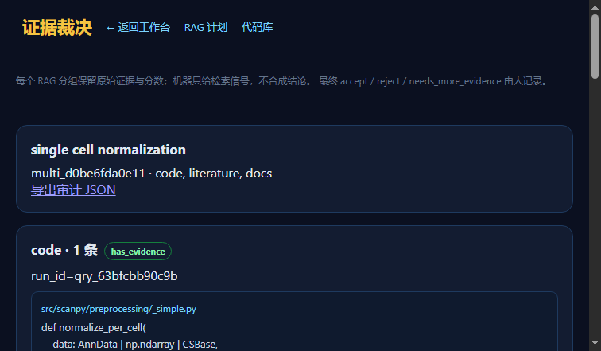

# 实验记录：R8 去重、冲突标记、审计导出

> 日期：2026-11-13  
> 状态：**dedup metadata / human conflict flags / JSON export 通过**  
> 页面：`/evidence.html`

---

## 1. 去重

证据按 `content_hash` 标记：

```text
duplicate_of = <first evidence_id>
```

不删除证据，只标记重复。  
本次 multi run `duplicate_count=0`。

## 2. 冲突

新增：

```text
rag_conflict_flags
```

人工操作：

```text
POST /api/rag/multi/<id>/conflicts
```

限制：

```text
必须人类 session
internal token 请求被拒绝
```

实测：

```text
flag_id cf_abe3d751f536
rag_id docs
note docs 证据与代码语义不一致，需人工复核
```

语义冲突不自动判定；只允许人标。

## 3. 审计导出

```text
GET /api/rag/multi/<id>/export.json
```

返回完整 multi run：

```text
查询
分组
证据
retrieval_signal
adjudications
conflicts
duplicate_count
```

实际：

```text
200
Content-Disposition attachment
4113 bytes
```

## 4. 截图



## 5. 验证

```text
tests.test_rag_adjudication 5 passed
validate_arch 239/239 OK
```

## 6. 边界

```text
去重只按内容哈希
没有语义冲突检测
没有自动裁决
没有统一分数
```

## 7. 下一步

```text
裁决审计列表
证据包导出 RO-Crate
多用户 reviewer 权限
```
