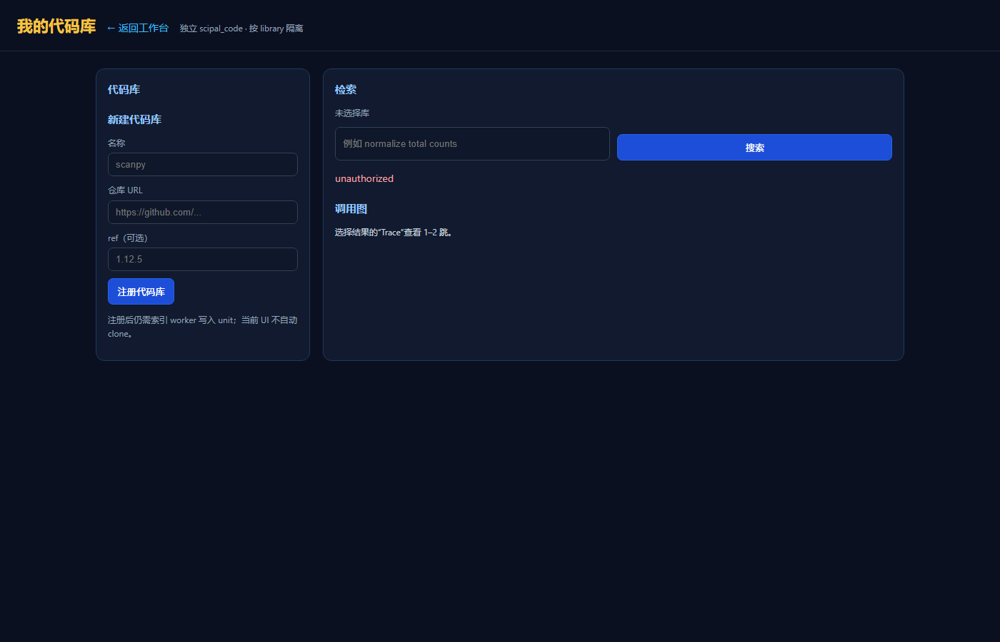

# 实验记录：代码库 UI 验收（A）

> 日期：2026-11-13  
> 状态：**本地源码可渲染；API 可通；浏览器未登录；生产容器旧镜像**  
> 页面：`http://127.0.0.1:5001/libraries.html`

---

## 1. 环境

```text
SciPal app     本地源码 127.0.0.1:5001
code-rag API   127.0.0.1:5010
生产 app       deploy-app-1:5000（旧镜像）
```

## 2. 结果

### 静态页面

```text
GET /libraries.html -> 200
```

浏览器截图：



页面布局正常：

```text
我的代码库
新建代码库
检索
调用图
```

### API（内部 token）

```text
GET /api/libraries?kind=code          200
GET /api/code/libraries/<id>/status   200
POST /api/code/libraries/<id>/search  200
```

搜索返回：

```text
normalize_total
src/scanpy/preprocessing/_normalization.py
```

### 浏览器未登录

```text
页面显示 unauthorized
```

原因：

```text
SCIPAL_AUTH_REQUIRED=1
没有登录会话
```

这不是 UI bug，是权限门禁。

## 3. 生产容器

`deploy-app-1`：

```text
/libraries.html -> 404
```

原因：

```text
容器是旧镜像，不含代码库 UI
```

要上生产必须：

```text
1. 重建 app 镜像
2. 注入 SCIPAL_CODE_API_URL=http://host.docker.internal:5010
3. 重启 caddy/app
```

## 4. 不能声称

```text
不能声称“浏览器端完整验收通过”
不能声称“生产 UI 已上线”
```

能声称：

```text
页面能渲染
代理/API 能通
权限门禁正常
```

## 5. 下一步

```text
B. C1 符号排序（已尝试失败，边界已定）
C. 版本/API 迁移题
```

或者：

```text
补登录会话后再做浏览器完整验收
```
