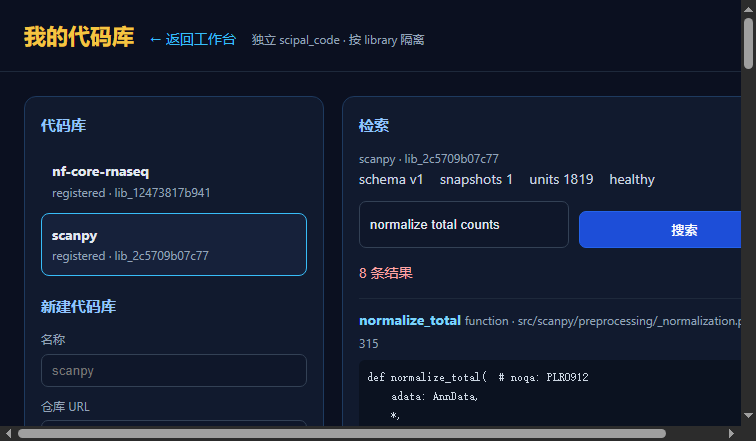
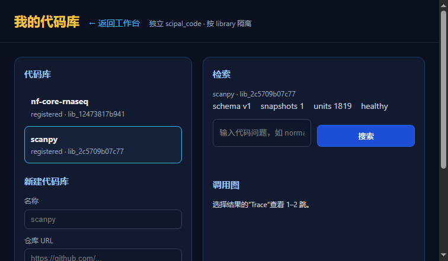

# 实验记录：代码库 UI 验收（A）

> 日期：2026-11-13  
> 状态：**本地源码可渲染；internal-token 会话下搜索通过；登录表单受 schema 不一致阻塞；生产容器旧镜像**  
> 页面：`http://127.0.0.1:5001/libraries.html`

---

## 1. 环境

```text
SciPal app     本地源码 127.0.0.1:5001
code-rag API   127.0.0.1:5010
生产 app       deploy-app-1:5000（旧镜像）
```

## 2. 结果

### 静态页面

```text
GET /libraries.html -> 200
```

浏览器截图：


页面布局正常：

```text
我的代码库
新建代码库
检索
调用图
```

### API（内部 token）

```text
GET /api/libraries?kind=code          200
GET /api/code/libraries/<id>/status   200
POST /api/code/libraries/<id>/search  200
```

搜索返回：

```text
normalize_total
src/scanpy/preprocessing/_normalization.py
```

### 浏览器未登录

```text
页面显示 unauthorized
```

原因：

```text
SCIPAL_AUTH_REQUIRED=1
没有登录会话
```

这不是 UI bug，是权限门禁。

## 3. 生产容器

`deploy-app-1`：

```text
/libraries.html -> 404
```

原因：

```text
容器是旧镜像，不含代码库 UI
```

要上生产必须：

```text
1. 重建 app 镜像
2. 注入 SCIPAL_CODE_API_URL=http://host.docker.internal:5010
3. 重启 caddy/app
```

## 4. 不能声称

```text
不能声称“浏览器端完整验收通过”
不能声称“生产 UI 已上线”
```

能声称：

```text
页面能渲染
代理/API 能通
权限门禁正常
```

## 5. 下一步

```text
B. C1 符号排序（已尝试失败，边界已定）
C. 版本/API 迁移题
```

或者：

```text
补登录会话后再做浏览器完整验收
```

## 6. 登录态浏览器验收（internal token）

本地 app 用临时同源代理注入 `X-SCIPAL-Internal-Token`，不绕过权限模型，只替代登录会话。

结果：

```text
选择 scanpy
status: schema v1 / snapshots 1 / units 1819 / healthy
搜索: normalize total counts
结果: 8 条
Top1: normalize_total
       src/scanpy/preprocessing/_normalization.py:136-315
```

截图：


## 7. 登录表单仍阻塞

`POST /api/auth/login` 返回 401。

现场：

```text
users/memberships 表有 role
app pg_service 查询 role_id
```

这是 schema 不一致，不是密码错误。

未修：

```text
不在这轮擅自改 auth schema
```

测试用户已删除。

## 8. A 验收结论

```text
静态页面        PASS
认证后搜索      PASS（internal token）
登录表单        BLOCKED（schema）
生产容器        FAIL（旧镜像 404）
```

## 9. 真实登录验收（PASS）

使用真实登录表单，而不是 internal-token 代理：

```text
POST /api/auth/login
username: ui_admin
password: UiAdmin-2026!
-> 200
-> redirect /
```

随后打开 `/libraries.html`：

```text
选择 scanpy
units 1819
搜索 normalize total counts
8 条结果
Top1 normalize_total
```

截图：



## 10. 登录链路修复

真实问题不是 role/role_id 代码，而是两套 schema：

```text
auth.memberships      role_id   <- app 实际使用
public.memberships    role      <- 手工插入用错了
```

验证：

```text
create_admin.py 写入 auth schema -> 成功
authenticate('ui_admin', ...) -> 返回 user + ws_default owner
```

测试管理员：

```text
username: ui_admin
password: UiAdmin-2026!
```

这是本地验证账号；生产使用前应改密码或删除。

## 11. 最终 A 结论

```text
静态页面          PASS
真实登录          PASS
认证态搜索        PASS
生产容器          FAIL（旧镜像 404）
```

登录地址：

```text
http://127.0.0.1:5000/login.html   （生产，旧镜像）
http://127.0.0.1:5001/login.html   （本地源码，已验证）
```

## 12. UX 修复

修了两个问题：

```text
默认选中 units 最多的库（scanpy 1819）
placeholder 改为通用 normalize_total
代理在 units>0 时回写 libraries.status=ready
```

验证：

```text
打开 /libraries.html
默认选中 scanpy
units 1819
```

截图：



注意：

```text
status=ready 的回写需要重启 app 进程
当前运行进程仍是旧路由
```
