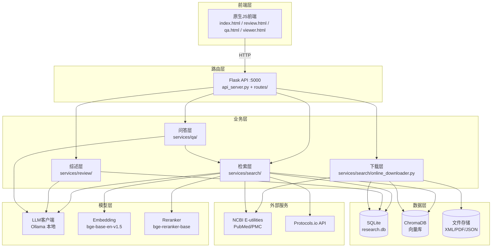
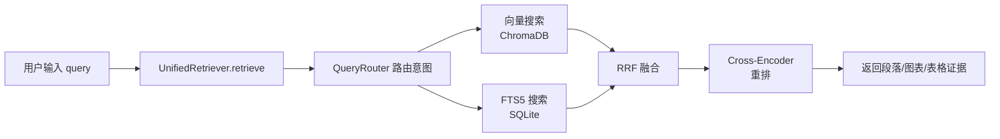
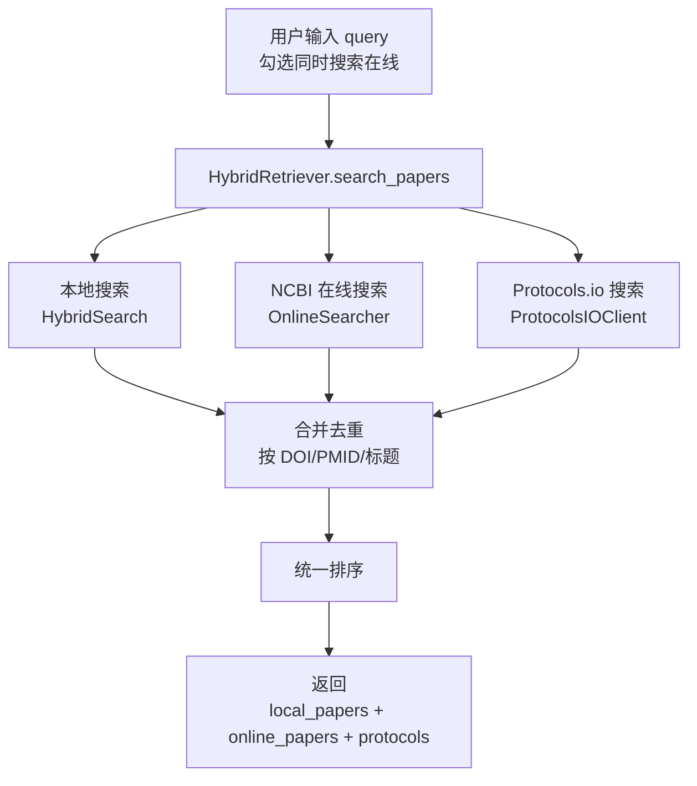
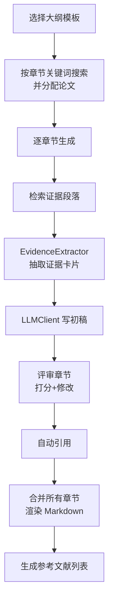

# 架构文档

## 环境约束（开发者必读）

- **目标系统**：Windows 10/11，Python 3.12（venv: `venv_sciPal_py312`）
- **路径处理**：统一使用 `pathlib.Path`，禁止硬编码 `/` 或 `\` 分隔符
  - ✅ `Path("data") / "research.db"`
  - ❌ `"data\\research.db"`、`"data/research.db"`（硬编码斜杠）
- **禁止使用的 Linux 专属命令**：`chmod`、`apt-get`、`kill`、`ps`、`grep`（用 Python 代替）
- **禁止使用的 Linux 专属库**：`fcntl`、`resource`、`pwd`、`grp`
- **控制台编码**：所有入口脚本开头必须加 `sys.stdout.reconfigure(encoding='utf-8')`，否则 Windows 控制台中文/ emoji 乱码
- **虚拟环境**：所有 Python 解释器路径用 `${workspaceFolder}/venv_sciPal_py312/Scripts/python.exe`
- **数据库**：SQLite（不需要 MySQL/PostgreSQL），向量库 ChromaDB 嵌入式
- **LLM**：Ollama 本地服务 `http://localhost:11434`，不需要云端 GPU

## 整体分层



```
┌─────────────────────────────────────────────────┐
│  前端（原生JS，无框架）                          │
│  index.html / review.html / qa.html / viewer.html │
└────────────────────┬────────────────────────────┘
                     │ HTTP API (Flask, :5000)
┌────────────────────▼────────────────────────────┐
│  API 路由层（routes/ + api_server.py）           │
│  /api/retrieve  /api/qa/ask  /api/review/*      │
│  /api/search/hybrid  /api/search/online 等       │
└──────┬──────────┬──────────┬──────────┬─────────┘
       │          │          │          │
┌──────▼──┐ ┌────▼────┐ ┌──▼─────┐ ┌──▼──────┐
│ 检索层   │ │ 综述层  │ │ 问答层  │ │ 下载层   │
│search/  │ │review/  │ │qa/     │ │online_  │
│         │ │         │ │         │ │downloader│
└────┬────┘ └────┬────┘ └───┬────┘ └────┬────┘
     │           │          │           │
┌────▼───────────▼──────────▼───────────▼─────────┐
│  数据层                                          │
│  SQLite (research.db) + ChromaDB (向量库)        │
│  PMC全文XML + PubMed摘要JSON                    │
└─────────────────────────────────────────────────┘
```

## 模块职责

### 检索层（services/search/）

| 模块 | 文件 | 职责 |
|------|------|------|
| UnifiedRetriever | `unified_retriever.py` | 统一检索器：段落+图表+表格+论文，带查询路由、向量召回、BM25、重排 |
| HybridSearch | `hybrid_search.py` | 本地混合搜索：向量+FTS5，用于本地论文搜索 |
| HybridRetriever | `hybrid_retriever.py` | 混合检索：本地+NCBI在线+Protocols.io，合并去重排序 |
| OnlineSearcher | `online_search.py` | NCBI E-utilities：PubMed + PMC 在线搜索 |
| OnlineDownloader | `online_downloader.py` | 异步下载 PMC 全文 → 导入数据库 → 建向量索引 |
| ProtocolsIOClient | `protocols_io_client.py` | Protocols.io API：实时搜索公开实验方法 |
| Reranker | `reranker.py` | Cross-Encoder 重排（bge-reranker-base） |
| QueryExpander | `query_expander.py` | 查询扩展（同义词、缩写展开） |
| QueryRouter | `query_router.py` | 查询意图路由（qa/citation/figure/method） |
| SentenceRelationClassifier | `sentence_relation_classifier.py` | 句子关系判定（问答用，综述不用） |
| RetrievalObservability | `retrieval_observability.py` | 检索可观测性（诊断日志） |

### 综述层（services/review/）

| 模块 | 文件 | 职责 |
|------|------|------|
| ReviewGenerator | `review_generator.py` | 综述生成主引擎：分章节→检索→证据抽取→写初稿→评审→自动引用 |
| EvidenceExtractor | `evidence_extractor.py` | 从段落中抽取证据卡片，去重、计算置信度 |
| EvidenceCardIncrementalManager | `evidence_card_incremental_manager.py` | 证据卡片增量维护 |
| LLMClient | `llm_client.py` | LLM 客户端（Ollama 本地 / OpenAI 兼容云端） |
| OutlineStore | `outline_store.py` | 大纲存储（JSON 文件，data/outlines/） |
| ReviewStore | `review_store.py` | 综述结果存储（内存缓存，带 TTL） |
| TaskManager | `task_manager.py` | 异步任务管理（生成综述的后台任务） |
| CitationFormatter | `citation_formatter.py` | 引用格式化（APA/Nature/Vancouver） |
| CitationVerifier | `citation_verifier.py` | 引用验证 |
| SentenceLocator | `sentence_locator.py` | 句子定位到原文位置 |
| ConflictDetector | `conflict_detector.py` | 冲突检测（问答用，综述不用） |
| RelationExtractor | `relation_extractor.py` | 关系抽取（问答用，综述不用） |
| UserFeedback | `user_feedback.py` | 用户反馈闭环 |
| ExportManager | `export_manager.py` | 导出与分享 |
| ImpactAnalyzer | `impact_analyzer.py` | 影响范围评估与局部重算 |
| Models | `models.py` | 数据模型（ReviewOutline、ReviewOutput、EvidenceCard 等） |

### 问答层（services/qa/）

| 模块 | 文件 | 职责 |
|------|------|------|
| QAService | `qa_service.py` | RAG 问答：检索→构建上下文→LLM生成答案→解析引用 |

### AI 服务层（services/ai/）

| 模块 | 文件 | 职责 |
|------|------|------|
| AIService | `ai_service.py` | AI 服务封装 |
| EnvelopeBuilder | `envelope_builder.py` | 证据信封构建 |
| RAGValidator | `rag_validator.py` | RAG 验证 |

### 其他

| 模块 | 文件 | 职责 |
|------|------|------|
| PDF Annotator | `pdf/annotator.py` | PDF 标注 |
| VersionManager | `data/version_manager.py` | 版本管理与增量同步 |
| RetryUtils | `utils/retry_utils.py` | 统一重试机制 |
| StructuredLogger | `utils/structured_logger.py` | 结构化日志 |

## 数据流

### 搜索流程



### 混合搜索流程（带在线）



### 综述生成流程



### 在线下载流程


## 数据存储

| 存储 | 路径 | 内容 |
|------|------|------|
| SQLite | `data/research.db` | 论文元数据、章节结构、段落、图表、证据卡片 |
| SQLite | `data/abstracts.db` | 摘要库 |
| ChromaDB | `data/chroma/` | 全文段落向量（collection: sci_pal_paragraphs） |
| ChromaDB | `data/chroma_abstracts/` | 摘要向量 |
| JSON | `data/outlines/` | 已保存的大纲 |
| JSON | `data/protocols_io_cache/` | Protocols.io API 缓存（7天过期） |
| XML | `documents_xml/` | PMC 全文 XML 文件 |
| JSON | `abstracts_xml/` | PubMed 摘要 JSON |

## 外部依赖

| 服务 | 用途 | 认证方式 |
|------|------|----------|
| Ollama | 本地 LLM 推理 | 无（localhost:11434） |
| NCBI E-utilities | PubMed/PMC 搜索 | API Key（环境变量） |
| Protocols.io API | 实验方法搜索 | Bearer Token（环境变量） |
| ChromaDB | 向量检索 | 本地嵌入式 |

## 模块依赖关系

```
api_server.py
  ├── UnifiedRetriever (services/search/)
  │     ├── HybridSearch (向量+FTS)
  │     ├── Reranker
  │     ├── QueryRouter
  │     └── RetrievalObservability
  ├── HybridRetriever (services/search/)
  │     ├── HybridSearch
  │     ├── OnlineSearcher
  │     └── ProtocolsIOClient
  ├── OnlineDownloader
  ├── ReviewGenerator (services/review/)
  │     ├── EvidenceExtractor
  │     ├── LLMClient
  │     ├── OutlineStore
  │     ├── ReviewStore
  │     └── TaskManager
  ├── QAService (services/qa/)
  │     └── UnifiedRetriever
  └── AIService
```

## 关键设计决策

1. **SQLite 管关系，ChromaDB 管语义**：两者通过 paper_id 挂钩，新增数据只更新这两个存储，检索层代码不改
2. **三层数据架构**：能 API 对接的不下载（Protocols.io），能实时搜索的不建库（NCBI 在线），必须本地建的才下载（PMC 全文）
3. **综述不用关系抽取/冲突检测**：这些是问答功能用的，综述生成时跳过
4. **单例模式**：Retriever、LLMClient、OnlineSearcher 等重型组件用单例，避免重复加载模型
5. **异步下载**：在线下载用后台线程 + TaskManager，不阻塞 API

## 核心接口与边界

### 公共函数（其他模块可以调用）

| 模块 | 公共方法 | 说明 |
|------|----------|------|
| `UnifiedRetriever` | `retrieve(query, ...)` | 统一检索入口，返回段落/图表/表格 |
| `HybridRetriever` | `search_papers(query, ...)` | 混合搜索入口，返回本地+在线+方法 |
| `OnlineSearcher` | `search(query, ...)` | NCBI 在线搜索入口 |
| `ProtocolsIOClient` | `search(query, ...)` | Protocols.io 搜索入口 |
| `OnlineDownloader` | `start_download(pmc_ids)` | 启动异步下载 |
| `ReviewGenerator` | `generate(topic, ...)` | 综述生成入口 |
| `EvidenceExtractor` | `extract_from_paragraphs(paragraphs, ...)` | 证据卡片抽取 |
| `LLMClient` | `chat(system, user, ...)` / `chat_json(...)` | LLM 调用入口 |
| `QAService` | `ask(question, ...)` | RAG 问答入口 |
| `OutlineStore` | `save/load/list/delete/exists` | 大纲存储 CRUD |
| `TaskManager` | `create_task/get_task/cancel_task/...` | 异步任务管理 |

### 私有函数（以下划线开头，禁止跨模块调用）

所有 `_` 开头的方法都是模块内部实现细节：
- `_rate_limit_wait()`、`_cache_get()`、`_cache_set()` — 缓存和限速
- `_esearch()`、`_esummary()`、`_request()` — HTTP 请求
- `_search_local()`、`_search_online()`、`_search_protocols_io()` — 内部搜索
- `_normalize_local_paper()`、`_normalize_online_result()` — 数据规范化
- `_is_duplicate()`、`_extract_identifiers()` — 去重逻辑
- `_write_draft()`、`_write_section()`、`_review_section()` — 综述内部步骤
- `_build_user_prompt()`、`_parse_evidence_type()` — 证据抽取内部
- `_run_download()`、`_import_new_papers()`、`_incremental_index()` — 下载内部流程

### 绝对不能跨模块调用的

| 禁止行为 | 原因 |
|----------|------|
| 综述层直接调 `SQLite` 或 `ChromaDB` | 必须通过检索层，保证检索逻辑统一 |
| 问答层直接调 `EvidenceExtractor` | 问答用自己的证据链路，不混用综述的 |
| 下载层直接调 `LLMClient` | 下载只负责取数据，不做 AI 推理 |
| 检索层直接调 `ReviewGenerator` | 检索是被调用方，不能反向依赖业务层 |
| 任何模块直接读写 `data/*.db` 文件 | 必须通过 DAO 层（database/init_db.py） |
| 前端直接调外部 API（NCBI/Protocols.io） | 必须通过后端代理，保护 API Key |
