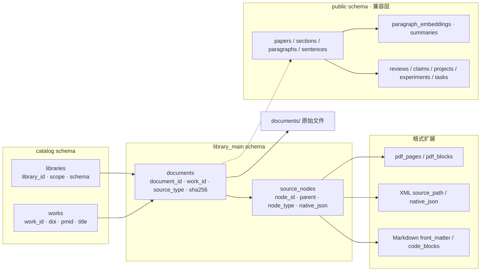
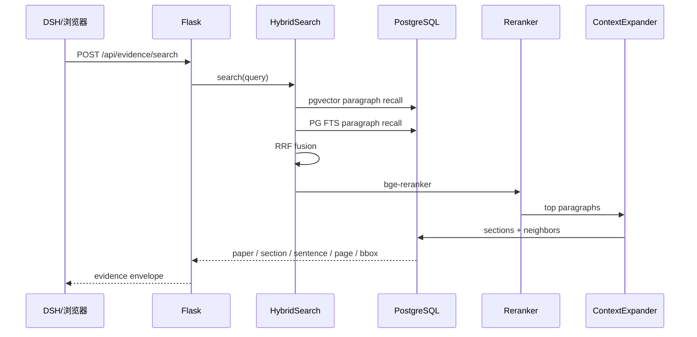

# SciPal 架构与路由全景图

> **2026-11-12 当前状态（覆盖下方历史数字）**
>
> - 运行栈：Flask + PostgreSQL 16 + pgvector；`scipal_core` / `scipal_rebuild` 物理分离
> - 路由：26 蓝图 / 204 route+method（开启 ingest-tracking 后 27 / 210）
> - 鉴权：session / bearer / 内部 token；生产 `SCIPAL_ENV=production`
> - 数据：13,201 论文 / 410,270 段落 / 1,780,306 句 / 343,546 向量
> - 运维：加密备份、GIN+HNSW 恢复演练、治理门禁
> - 详细契约：`ARCHITECTURE.md`、`ARCHITECTURE.json`、`docs/数据层隔离审计.md`


> 日期：2026-11-08 · PG-only  
> 来源：`ARCHITECTURE.json` + Flask `url_map`  
> 细度：26 个蓝图、204 route+method（开启 ingest-tracking 后 210）

配套：

- [架构与路由图](架构与路由图.md) — 分层说明
- [开发-模块手册](开发-模块手册.md) — 按模块找入口
- [ARCHITECTURE.json](../ARCHITECTURE.json) — 机器可读

---

## 1. 系统全景

```mermaid
flowchart TB
  subgraph CLIENT["客户端"]
    WEB["浏览器<br/>HTML / JS / PDF.js"]
    DSH["DSH / MCP"]
  end

  subgraph API["Flask API · 26 blueprints · 204 route+method"]
    GW["Blueprint router<br/>session / tenancy / JSON"]
    A_CORE["core / system<br/>health · retrieve · graph"]
    A_PAPERS["papers / papers_actions<br/>detail · parse · trace"]
    A_SEARCH["search / search_downloads<br/>hybrid · online · download"]
    A_EVID["evidence / qa<br/>evidence · ask · verify"]
    A_REVIEW["reviews / review_actions / review_projects<br/>generate · screen · PRISMA"]
    A_CLAIM["claims<br/>cards · evidence · events"]
    A_PROJ["projects<br/>projects · members"]
    A_EXP["experiments / experiment_runs<br/>experiments · runs · signatures"]
    A_WATCH["watch<br/>profiles · runs · digest"]
    A_TEN["tenancy<br/>auth · workspaces · members"]
    A_TASK["tasks / ingest<br/>tasks · PMC ingest"]
    A_LIB["library / data<br/>catalog · local tables"]
    A_MISC["notes / references / abstracts<br/>protocols / guard / domain_packs"]
  end

  subgraph SVC["services/*"]
    S_SEARCH["search<br/>pgvector · PG FTS · RRF · rerank · context"]
    S_EVID["evidence / qa<br/>unified retriever · verifier"]
    S_REVIEW["review<br/>generator · systematic · export"]
    S_CLAIM["claims<br/>service · pg_read · pg_writes"]
    S_PROJ["projects / experiments<br/>pg_service · pg_write"]
    S_WATCH["watch<br/>discovery · runner · repo"]
    S_TEN["tenancy<br/>service · web · schema"]
    S_TASK["tasks / ingest<br/>task manager · downloader"]
    S_OTHER["notes / references / abstracts<br/>protocols / guard / data"]
  end

  subgraph BUILD["build_db/*"]
    B_PARSE["parsers / JATS import<br/>structure rebuild"]
    B_LINK["sentence geometry / links<br/>figures / tables"]
    B_WRITE["PG writers / preflight<br/>backfill"]
  end

  subgraph STORE["存储"]
    PG[("PostgreSQL 16 + pgvector<br/>public + catalog + library_main")]
    FILES["documents / reports / packs"]
    ARCHIVE["归档<br/>research.db · Chroma"]
  end

  subgraph EXT["外部"]
    EPMC["Europe PMC / PMC"]
    OA["OpenAlex / Crossref"]
    LLM["DeepSeek / Ollama"]
  end

  WEB --> GW
  DSH --> GW

  GW --> A_CORE
  GW --> A_PAPERS
  GW --> A_SEARCH
  GW --> A_EVID
  GW --> A_REVIEW
  GW --> A_CLAIM
  GW --> A_PROJ
  GW --> A_EXP
  GW --> A_WATCH
  GW --> A_TEN
  GW --> A_TASK
  GW --> A_LIB
  GW --> A_MISC

  A_CORE --> S_SEARCH
  A_PAPERS --> S_SEARCH
  A_SEARCH --> S_SEARCH
  A_EVID --> S_EVID
  A_REVIEW --> S_REVIEW
  A_CLAIM --> S_CLAIM
  A_PROJ --> S_PROJ
  A_EXP --> S_PROJ
  A_WATCH --> S_WATCH
  A_TEN --> S_TEN
  A_TASK --> S_TASK
  A_MISC --> S_OTHER

  S_SEARCH --> PG
  S_EVID --> PG
  S_REVIEW --> PG
  S_CLAIM --> PG
  S_PROJ --> PG
  S_WATCH --> PG
  S_TEN --> PG
  S_TASK --> PG
  S_OTHER --> PG

  B_PARSE --> B_WRITE
  B_LINK --> B_WRITE
  B_WRITE --> PG
  B_WRITE --> FILES
  ARCHIVE -.-> PG

  S_TASK --> EPMC
  S_WATCH --> EPMC
  S_WATCH --> OA
  S_REVIEW --> LLM
  S_EVID --> LLM
```



---

## 2. 数据层全景



约束：

```text
catalog.works         work 级身份
library_main.documents  work + source_type + sha256
library_main.source_nodes 公共树 + native_json
public                现有运行数据，P1 回填前仍是主读路径
```

---

## 3. 检索请求流



强制过滤：

```text
papers.duplicate_of IS NULL
```

---

## 4. 蓝图与路由数量

| Blueprint | Routes |
|---|---:|
| `abstracts` | 2 |
| `app` | 2 |
| `claims` | 9 |
| `core` | 2 |
| `data` | 12 |
| `domain_packs` | 4 |
| `evidence` | 3 |
| `experiment_runs` | 5 |
| `experiments` | 12 |
| `guard` | 3 |
| `ingest` | 4 |
| `notes` | 4 |
| `papers` | 3 |
| `papers_actions` | 14 |
| `projects` | 6 |
| `protocols` | 14 |
| `qa` | 5 |
| `references` | 2 |
| `review_actions` | 9 |
| `review_projects` | 26 |
| `reviews` | 8 |
| `search` | 5 |
| `search_downloads` | 3 |
| `system` | 2 |
| `tasks` | 3 |
| `tenancy` | 9 |
| `watch` | 14 |
| **合计** | **185（2026-11-08 快照；当前 204）** |

---

## 5. 全部 API 路由

| # | Blueprint | Methods | Rule | Handler |
|---:|---|---|---|---|
| 1 | `abstracts` | `GET` | `/api/abstracts/<paper_id>` | `abstracts.get_abstract` |
| 2 | `abstracts` | `GET` | `/api/abstracts/list` | `abstracts.list_abstracts` |
| 3 | `app` | `GET` | `/` | `index` |
| 4 | `app` | `GET` | `/<path:path>` | `static_files` |
| 5 | `claims` | `GET` | `/api/claims` | `claims.listing` |
| 6 | `claims` | `GET` | `/api/claims/` | `claims.listing` |
| 7 | `claims` | `GET` | `/api/claims/<claim_id>` | `claims.detail` |
| 8 | `claims` | `POST` | `/api/claims/<claim_id>/decision` | `claims.decision` |
| 9 | `claims` | `GET` | `/api/claims/<claim_id>/events` | `claims.events` |
| 10 | `claims` | `POST` | `/api/claims/<claim_id>/evidence` | `claims.evidence` |
| 11 | `claims` | `POST` | `/api/claims/<claim_id>/interrogate` | `claims.interrogate` |
| 12 | `claims` | `POST` | `/api/claims/<claim_id>/note` | `claims.note` |
| 13 | `claims` | `POST` | `/api/claims/<claim_id>/search` | `claims.search` |
| 14 | `core` | `GET` | `/api/health` | `core.health` |
| 15 | `core` | `GET,POST` | `/api/retrieve` | `core.retrieve` |
| 16 | `data` | `POST` | `/api/data/aggregate` | `data.aggregate` |
| 17 | `data` | `GET` | `/api/data/artifacts` | `data.artifacts` |
| 18 | `data` | `GET,PUT` | `/api/data/artifacts/<artifact_id>` | `data.artifact` |
| 19 | `data` | `POST` | `/api/data/artifacts/<artifact_id>/validate` | `data.validate` |
| 20 | `data` | `GET` | `/api/data/audit` | `data.audit_log` |
| 21 | `data` | `GET` | `/api/data/classify` | `data.classify` |
| 22 | `data` | `POST` | `/api/data/cloud-gate` | `data.cloud_gate` |
| 23 | `data` | `POST` | `/api/data/cloud-send` | `data.cloud_send` |
| 24 | `data` | `POST` | `/api/data/profile` | `data.profile` |
| 25 | `data` | `GET` | `/api/data/projects` | `data.projects` |
| 26 | `data` | `POST` | `/api/data/sample` | `data.sample` |
| 27 | `data` | `POST` | `/api/data/session` | `data.open_session` |
| 28 | `domain_packs` | `GET` | `/api/domain-packs` | `domain_packs.packs` |
| 29 | `domain_packs` | `GET` | `/api/domain-packs/` | `domain_packs.packs` |
| 30 | `domain_packs` | `GET` | `/api/domain-packs/<pack_id>` | `domain_packs.detail` |
| 31 | `domain_packs` | `GET` | `/api/domain-packs/<pack_id>/validate` | `domain_packs.validate` |
| 32 | `evidence` | `GET` | `/api/evidence/context` | `evidence.evidence_context` |
| 33 | `evidence` | `GET,POST` | `/api/evidence/search` | `evidence.evidence_search` |
| 34 | `evidence` | `POST` | `/api/verify` | `evidence.verify` |
| 35 | `experiment_runs` | `GET` | `/api/experiments/<experiment_id>/runs` | `experiment_runs.runs_list` |
| 36 | `experiment_runs` | `POST` | `/api/experiments/<experiment_id>/runs` | `experiment_runs.runs_create` |
| 37 | `experiment_runs` | `GET` | `/api/runs/<run_id>` | `experiment_runs.runs_detail` |
| 38 | `experiment_runs` | `PUT` | `/api/runs/<run_id>` | `experiment_runs.runs_update` |
| 39 | `experiment_runs` | `GET` | `/api/runs/<run_id>/comparison` | `experiment_runs.runs_comparison` |
| 40 | `experiments` | `GET` | `/api/experiment-access-requests` | `experiments.experiment_access_requests` |
| 41 | `experiments` | `GET` | `/api/experiments/<experiment_id>` | `experiments.experiments_detail` |
| 42 | `experiments` | `PUT` | `/api/experiments/<experiment_id>` | `experiments.experiments_update` |
| 43 | `experiments` | `GET` | `/api/experiments/<experiment_id>/access-requests` | `experiments.experiment_list_access` |
| 44 | `experiments` | `POST` | `/api/experiments/<experiment_id>/access-requests` | `experiments.experiment_request_access` |
| 45 | `experiments` | `POST` | `/api/experiments/<experiment_id>/access-requests/<request_id>/decide` | `experiments.experiment_decide_access` |
| 46 | `experiments` | `GET` | `/api/experiments/<experiment_id>/audit` | `experiments.experiment_audit` |
| 47 | `experiments` | `GET` | `/api/experiments/<experiment_id>/revisions` | `experiments.experiment_revisions` |
| 48 | `experiments` | `POST` | `/api/experiments/<experiment_id>/sign` | `experiments.experiment_sign` |
| 49 | `experiments` | `GET` | `/api/experiments/<experiment_id>/signatures` | `experiments.experiment_signatures` |
| 50 | `experiments` | `GET` | `/api/projects/<project_id>/experiments` | `experiments.experiments_list` |
| 51 | `experiments` | `POST` | `/api/projects/<project_id>/experiments` | `experiments.experiments_create` |
| 52 | `guard` | `POST` | `/api/guard/check` | `guard.check` |
| 53 | `guard` | `GET` | `/api/guard/stats` | `guard.stats` |
| 54 | `guard` | `GET` | `/api/guard/term/<term>` | `guard.term` |
| 55 | `ingest` | `POST` | `/api/embed` | `ingest.embed` |
| 56 | `ingest` | `POST` | `/api/ingest` | `ingest.start_ingest` |
| 57 | `ingest` | `GET` | `/api/ingest/<task_id>` | `ingest.ingest_status` |
| 58 | `ingest` | `POST` | `/api/ingest/<task_id>/cancel` | `ingest.cancel_ingest` |
| 59 | `notes` | `GET` | `/api/notes` | `notes.notes_list` |
| 60 | `notes` | `POST` | `/api/notes` | `notes.notes_create` |
| 61 | `notes` | `DELETE` | `/api/notes/<note_id>` | `notes.notes_delete` |
| 62 | `notes` | `PUT` | `/api/notes/<note_id>` | `notes.notes_update` |
| 63 | `papers` | `GET` | `/api/papers` | `papers.list_papers` |
| 64 | `papers` | `GET` | `/api/papers/<paper_id>` | `papers.paper_detail` |
| 65 | `papers` | `GET` | `/api/papers/<paper_id>/graph` | `papers.paper_graph` |
| 66 | `papers_actions` | `POST` | `/api/papers/<paper_id>/annotate` | `papers_actions.annotate_pdf` |
| 67 | `papers_actions` | `GET` | `/api/papers/<paper_id>/annotations` | `papers_actions.list_pdf_annotations` |
| 68 | `papers_actions` | `GET` | `/api/papers/<paper_id>/pdf` | `papers_actions.serve_pdf` |
| 69 | `papers_actions` | `GET` | `/api/papers/<paper_id>/supplementary` | `papers_actions.list_supplementary_files` |
| 70 | `papers_actions` | `POST` | `/api/papers/<paper_id>/supplementary` | `papers_actions.upload_supplementary_file` |
| 71 | `papers_actions` | `DELETE` | `/api/papers/<paper_id>/supplementary/<supp_id>` | `papers_actions.delete_supplementary_file` |
| 72 | `papers_actions` | `GET` | `/api/papers/<paper_id>/supplementary/<supp_id>/download` | `papers_actions.download_supplementary_file` |
| 73 | `papers_actions` | `POST` | `/api/papers/<paper_id>/supplementary/link` | `papers_actions.link_supplementary_file` |
| 74 | `papers_actions` | `GET` | `/api/papers/<paper_id>/trace` | `papers_actions.sentence_trace` |
| 75 | `papers_actions` | `GET` | `/api/papers/<paper_id>/trace.png` | `papers_actions.sentence_trace_image` |
| 76 | `papers_actions` | `POST` | `/api/papers/import` | `papers_actions.import_paper` |
| 77 | `papers_actions` | `GET` | `/api/papers/local` | `papers_actions.list_local_papers` |
| 78 | `papers_actions` | `POST` | `/api/papers/parse` | `papers_actions.parse_local_paper` |
| 79 | `papers_actions` | `POST` | `/api/papers/parse_async` | `papers_actions.parse_local_paper_async` |
| 80 | `projects` | `GET` | `/api/projects` | `projects.projects_list` |
| 81 | `projects` | `POST` | `/api/projects` | `projects.projects_create` |
| 82 | `projects` | `GET` | `/api/projects/<project_id>` | `projects.projects_detail` |
| 83 | `projects` | `PUT` | `/api/projects/<project_id>` | `projects.projects_update` |
| 84 | `projects` | `POST` | `/api/projects/<project_id>/copy` | `projects.projects_copy` |
| 85 | `projects` | `POST` | `/api/projects/<project_id>/members` | `projects.projects_add_member` |
| 86 | `protocols` | `GET` | `/api/experiments` | `protocols.recent_runs` |
| 87 | `protocols` | `DELETE` | `/api/experiments/<run_id>` | `protocols.delete_run` |
| 88 | `protocols` | `PATCH` | `/api/experiments/<run_id>` | `protocols.update_run` |
| 89 | `protocols` | `GET` | `/api/experiments/<run_id>/attachments` | `protocols.list_attachments` |
| 90 | `protocols` | `POST` | `/api/experiments/<run_id>/attachments` | `protocols.upload_attachment` |
| 91 | `protocols` | `DELETE` | `/api/experiments/<run_id>/attachments/<file_id>` | `protocols.delete_attachment` |
| 92 | `protocols` | `GET` | `/api/experiments/<run_id>/attachments/<file_id>` | `protocols.download_attachment` |
| 93 | `protocols` | `GET` | `/api/protocols` | `protocols.list_protocols` |
| 94 | `protocols` | `GET` | `/api/protocols/<protocol_id>` | `protocols.get_protocol` |
| 95 | `protocols` | `GET` | `/api/protocols/<protocol_id>/export` | `protocols.export_protocol` |
| 96 | `protocols` | `GET` | `/api/protocols/<protocol_id>/runs` | `protocols.list_runs` |
| 97 | `protocols` | `POST` | `/api/protocols/<protocol_id>/runs` | `protocols.add_run` |
| 98 | `protocols` | `POST` | `/api/protocols/import` | `protocols.import_protocol` |
| 99 | `protocols` | `POST` | `/api/reviews/<review_id>/to-protocol` | `protocols.review_to_protocol` |
| 100 | `qa` | `GET,POST` | `/api/agentic/search` | `qa.agentic_search` |
| 101 | `qa` | `POST` | `/api/agentic/search_async` | `qa.agentic_search_async` |
| 102 | `qa` | `POST` | `/api/qa/ask` | `qa.qa_ask` |
| 103 | `qa` | `POST` | `/api/qa/ask_async` | `qa.qa_ask_async` |
| 104 | `qa` | `GET` | `/api/qa/status` | `qa.qa_status` |
| 105 | `references` | `GET` | `/api/references` | `references.list_references` |
| 106 | `references` | `POST` | `/api/references/import` | `references.import_references` |
| 107 | `review_actions` | `POST` | `/api/review/assign_papers` | `review_actions.assign_papers_to_outline_route` |
| 108 | `review_actions` | `GET,POST` | `/api/review/generate` | `review_actions.generate_review` |
| 109 | `review_actions` | `POST` | `/api/review/generate_async` | `review_actions.generate_review_async` |
| 110 | `review_actions` | `GET,POST` | `/api/review/outline` | `review_actions.generate_outline` |
| 111 | `review_actions` | `POST` | `/api/review/outline/save` | `review_actions.save_outline` |
| 112 | `review_actions` | `GET` | `/api/review/outline/saved` | `review_actions.list_saved_outlines` |
| 113 | `review_actions` | `DELETE` | `/api/review/outline/saved/<name>` | `review_actions.delete_saved_outline` |
| 114 | `review_actions` | `GET` | `/api/review/outline/saved/<name>` | `review_actions.load_saved_outline` |
| 115 | `review_actions` | `POST` | `/api/review/search_and_assign` | `review_actions.search_and_assign_route` |
| 116 | `review_projects` | `GET,POST` | `/api/review-projects` | `review_projects.projects` |
| 117 | `review_projects` | `GET` | `/api/review-projects/<project_id>` | `review_projects.project` |
| 118 | `review_projects` | `POST` | `/api/review-projects/<project_id>/adjudicate` | `review_projects.adjudicate` |
| 119 | `review_projects` | `GET` | `/api/review-projects/<project_id>/brief` | `review_projects.review_brief` |
| 120 | `review_projects` | `GET` | `/api/review-projects/<project_id>/conflicts` | `review_projects.screening_conflicts` |
| 121 | `review_projects` | `GET` | `/api/review-projects/<project_id>/events` | `review_projects.review_events` |
| 122 | `review_projects` | `GET,POST` | `/api/review-projects/<project_id>/evidence` | `review_projects.evidence` |
| 123 | `review_projects` | `GET` | `/api/review-projects/<project_id>/evidence.csv` | `review_projects.evidence_csv` |
| 124 | `review_projects` | `GET` | `/api/review-projects/<project_id>/export.json` | `review_projects.export_project` |
| 125 | `review_projects` | `POST` | `/api/review-projects/<project_id>/from-watch` | `review_projects.from_watch` |
| 126 | `review_projects` | `POST` | `/api/review-projects/<project_id>/import-file` | `review_projects.import_file` |
| 127 | `review_projects` | `POST` | `/api/review-projects/<project_id>/import-records` | `review_projects.import_records` |
| 128 | `review_projects` | `GET` | `/api/review-projects/<project_id>/kappa` | `review_projects.screening_kappa` |
| 129 | `review_projects` | `GET,POST` | `/api/review-projects/<project_id>/members` | `review_projects.project_members` |
| 130 | `review_projects` | `POST` | `/api/review-projects/<project_id>/papers` | `review_projects.papers` |
| 131 | `review_projects` | `POST` | `/api/review-projects/<project_id>/pico` | `review_projects.extract_pico` |
| 132 | `review_projects` | `GET` | `/api/review-projects/<project_id>/prisma` | `review_projects.prisma` |
| 133 | `review_projects` | `GET` | `/api/review-projects/<project_id>/prisma.svg` | `review_projects.prisma_diagram` |
| 134 | `review_projects` | `GET` | `/api/review-projects/<project_id>/report.docx` | `review_projects.review_report_docx` |
| 135 | `review_projects` | `GET` | `/api/review-projects/<project_id>/report.html` | `review_projects.review_report` |
| 136 | `review_projects` | `GET` | `/api/review-projects/<project_id>/report.pdf` | `review_projects.review_report_pdf` |
| 137 | `review_projects` | `GET,POST` | `/api/review-projects/<project_id>/risk-of-bias` | `review_projects.rob` |
| 138 | `review_projects` | `POST` | `/api/review-projects/<project_id>/screen` | `review_projects.screen` |
| 139 | `review_projects` | `GET,POST` | `/api/review-projects/<project_id>/webhooks` | `review_projects.webhooks` |
| 140 | `review_projects` | `DELETE` | `/api/review-projects/<project_id>/webhooks/<int:webhook_id>` | `review_projects.delete_webhook` |
| 141 | `review_projects` | `POST` | `/api/review-projects/import` | `review_projects.import_project` |
| 142 | `reviews` | `GET` | `/api/review/<review_id>` | `reviews.review_detail` |
| 143 | `reviews` | `GET` | `/api/review/<review_id>/sentence/<sentence_id>` | `reviews.review_sentence` |
| 144 | `reviews` | `POST` | `/api/review/cancel/<task_id>` | `reviews.review_cancel` |
| 145 | `reviews` | `GET` | `/api/review/llm_status` | `reviews.review_llm_status` |
| 146 | `reviews` | `GET` | `/api/review/running_task` | `reviews.review_running_task` |
| 147 | `reviews` | `GET` | `/api/review/task/<task_id>` | `reviews.review_task` |
| 148 | `reviews` | `GET` | `/api/reviews` | `reviews.list_reviews` |
| 149 | `reviews` | `GET` | `/api/reviews/<review_id>` | `reviews.get_review` |
| 150 | `search` | `GET` | `/api/search/download_history` | `search.download_history` |
| 151 | `search` | `GET` | `/api/search/download_queue` | `search.download_queue_status` |
| 152 | `search` | `GET` | `/api/search/download_status` | `search.download_status` |
| 153 | `search` | `GET,POST` | `/api/search/hybrid` | `search.hybrid_search` |
| 154 | `search` | `GET,POST` | `/api/search/online` | `search.online_search` |
| 155 | `search_downloads` | `POST` | `/api/search/clear_download_history` | `search_downloads.clear_download_history` |
| 156 | `search_downloads` | `POST` | `/api/search/download_online` | `search_downloads.download_online_papers` |
| 157 | `search_downloads` | `POST` | `/api/search/retry_download` | `search_downloads.retry_download` |
| 158 | `system` | `GET` | `/api/communities` | `system.list_communities` |
| 159 | `system` | `GET` | `/api/graph/stats` | `system.graph_stats` |
| 160 | `tasks` | `GET` | `/api/tasks` | `tasks.list_all` |
| 161 | `tasks` | `GET` | `/api/tasks/<task_id>` | `tasks.detail` |
| 162 | `tasks` | `GET` | `/api/tasks/<task_id>/events` | `tasks.events` |
| 163 | `tenancy` | `POST` | `/api/auth/login` | `tenancy.login` |
| 164 | `tenancy` | `POST` | `/api/auth/logout` | `tenancy.logout` |
| 165 | `tenancy` | `GET` | `/api/auth/me` | `tenancy.me` |
| 166 | `tenancy` | `POST` | `/api/auth/workspace` | `tenancy.switch_workspace` |
| 167 | `tenancy` | `GET` | `/api/workspaces` | `tenancy.workspaces` |
| 168 | `tenancy` | `POST` | `/api/workspaces` | `tenancy.create` |
| 169 | `tenancy` | `GET` | `/api/workspaces/<workspace_id>/members` | `tenancy.members` |
| 170 | `tenancy` | `POST` | `/api/workspaces/<workspace_id>/members` | `tenancy.add` |
| 171 | `tenancy` | `GET` | `/api/workspaces/<workspace_id>/role` | `tenancy.role` |
| 172 | `watch` | `POST` | `/api/watch/items/<int:item_id>/feedback` | `watch.feedback` |
| 173 | `watch` | `POST` | `/api/watch/items/<int:item_id>/read` | `watch.read_item` |
| 174 | `watch` | `GET,POST` | `/api/watch/profiles` | `watch.profiles` |
| 175 | `watch` | `DELETE,GET,PUT` | `/api/watch/profiles/<int:profile_id>` | `watch.profile` |
| 176 | `watch` | `POST` | `/api/watch/profiles/<int:profile_id>/discover` | `watch.discover` |
| 177 | `watch` | `GET,PUT` | `/api/watch/profiles/<int:profile_id>/journals` | `watch.journals` |
| 178 | `watch` | `GET` | `/api/watch/profiles/<int:profile_id>/latest` | `watch.latest_profile` |
| 179 | `watch` | `POST` | `/api/watch/profiles/<int:profile_id>/run` | `watch.run` |
| 180 | `watch` | `GET` | `/api/watch/profiles/<int:profile_id>/runs` | `watch.runs` |
| 181 | `watch` | `GET` | `/api/watch/runs/<int:run_id>` | `watch.run_detail` |
| 182 | `watch` | `GET` | `/api/watch/runs/<int:run_id>/digest.md` | `watch.digest` |
| 183 | `watch` | `GET` | `/api/watch/runs/<int:run_id>/latest` | `watch.latest` |
| 184 | `watch` | `POST` | `/api/watch/runs/<int:run_id>/read-all` | `watch.read_all` |
| 185 | `watch` | `GET` | `/api/watch/topics` | `watch.topics` |

---

## 6. 维护方式

```text
改路由
  -> 改 ARCHITECTURE.json
  -> python scripts/validate_arch.py
  -> pre-commit hook 自动校验
  -> arch-guard CI
```

本文件的完整路由表由 `api_server.app.url_map` 生成；路由变化后重新生成，避免手工漂移。
