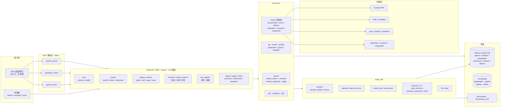
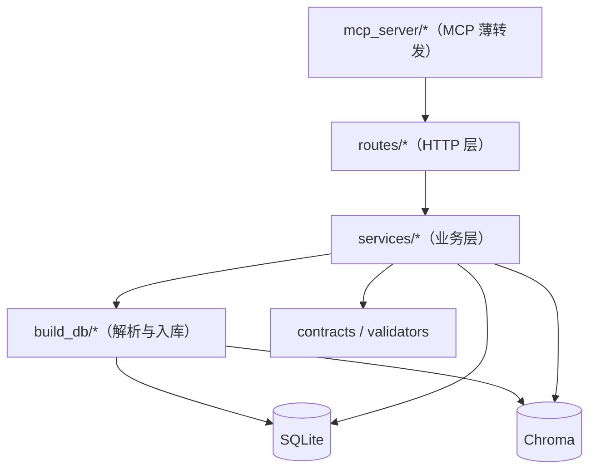
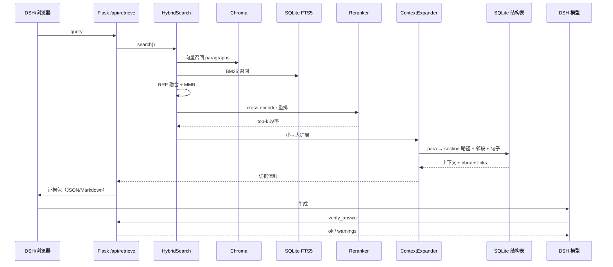
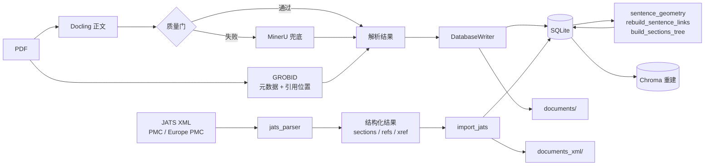
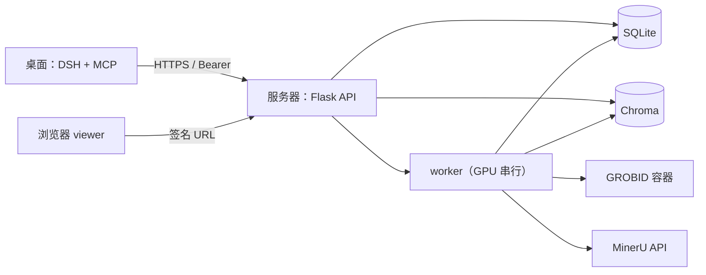

# SciPal 架构与路由图（V33.41）

> 本文用 Mermaid 绘制，Gitee 可直接渲染。曲线连线表示数据流方向。

## 1. 系统分层



## 2. 模块依赖



## 3. 检索与证据数据流



## 4. 入库数据流



## 5. 路由地图（82 条）

> 静态 `/`、`/<path:...>` 省略；方法以实际注册为准。

### core
| 方法 | 路径 |
|---|---|
| GET/POST | `/api/retrieve` |
| GET | `/api/health` |
| POST | `/api/embed` |
| GET | `/api/communities` |
| GET | `/api/graph/stats` |

### search
| 方法 | 路径 |
|---|---|
| GET/POST | `/api/search/hybrid` |
| GET/POST | `/api/search/online` |
| POST | `/api/search/download_online` |
| GET | `/api/search/download_status` |
| GET | `/api/search/download_history` |
| POST | `/api/search/clear_download_history` |
| GET | `/api/search/download_queue` |
| POST | `/api/search/retry_download` |

### papers
| 方法 | 路径 |
|---|---|
| GET | `/api/papers` · `/api/papers/local` · `/api/papers/<id>` |
| POST | `/api/papers/parse` · `/api/papers/parse_async` · `/api/papers/import` |
| GET | `/api/papers/<id>/pdf` · `/api/papers/<id>/graph` |
| GET/POST | `/api/papers/<id>/supplementary` |
| DELETE | `/api/papers/<id>/supplementary/<supp_id>` |
| GET | `/api/papers/<id>/supplementary/<supp_id>/download` |
| POST | `/api/papers/<id>/supplementary/link` |
| POST | `/api/papers/<id>/annotate` · GET `/annotations` |
| GET | `/api/papers/<id>/trace` · `/trace.png` |

### qa / agentic
| 方法 | 路径 |
|---|---|
| POST | `/api/qa/ask` · `/api/qa/ask_async` |
| GET | `/api/qa/status` |
| GET/POST | `/api/agentic/search` |
| POST | `/api/agentic/search_async` |

### review
| 方法 | 路径 |
|---|---|
| GET/POST | `/api/review/generate` · `/api/review/outline` |
| POST | `/api/review/generate_async` · `/api/review/assign_papers` · `/api/review/search_and_assign` |
| GET | `/api/review/running_task` · `/api/review/llm_status` · `/api/review/task/<id>` |
| POST | `/api/review/cancel/<task_id>` |
| GET | `/api/review/<review_id>` · `/sentence/<sentence_id>` |
| GET | `/api/review/outline/saved` · POST `/save` · DELETE `/<name>` |
| GET | `/api/reviews` · `/api/reviews/<id>` |
| POST | `/api/reviews/<id>/to-protocol` |

### guard
| 方法 | 路径 |
|---|---|
| POST | `/api/guard/check` |
| GET | `/api/guard/stats` · `/api/guard/term/<term>` |

### ingest / tasks / protocols / references / abstracts / experiments
| 方法 | 路径 |
|---|---|
| POST | `/api/ingest` · `/api/ingest/<task_id>/cancel` |
| GET | `/api/ingest/<task_id>` |
| GET | `/api/tasks` · `/api/tasks/<id>` · `/api/tasks/<id>/events` |
| GET | `/api/protocols` · `/api/protocols/<id>` · `/export` |
| POST | `/api/protocols/import` · `/api/protocols/<id>/runs` |
| GET | `/api/references` · POST `/api/references/import` |
| GET | `/api/abstracts/list` · `/api/abstracts/<paper_id>` |
| GET | `/api/experiments` · PATCH/DELETE `/api/experiments/<run_id>` |
| GET/POST | `/api/experiments/<run_id>/attachments` |
| GET/DELETE | `/api/experiments/<run_id>/attachments/<file_id>` |

## 6. 存储结构

```
research.db
├─ papers                 元数据、parse_engine、acquisition
├─ sections               显式父子（parent_id），path/depth
├─ paragraphs             section_id/sequence/page/bbox
├─ sentences              para_id/sequence/page/bbox/char offsets
├─ citations              参考文献
├─ figures / tables       图表
├─ citation_mentions      正文引用位置（GROBID）
├─ sentence_links         句子 ↔ 引用/图/表（source/confidence）
├─ paper_links            文章图谱（cites/cited_by/similar）
├─ tasks / ingest_tasks   任务
└─ FTS: papers_fts, paragraphs_fts
```

Chroma：`paragraphs`（全文本）、`papers`、`figures`、`tables`。

## 7. 部署拓扑


