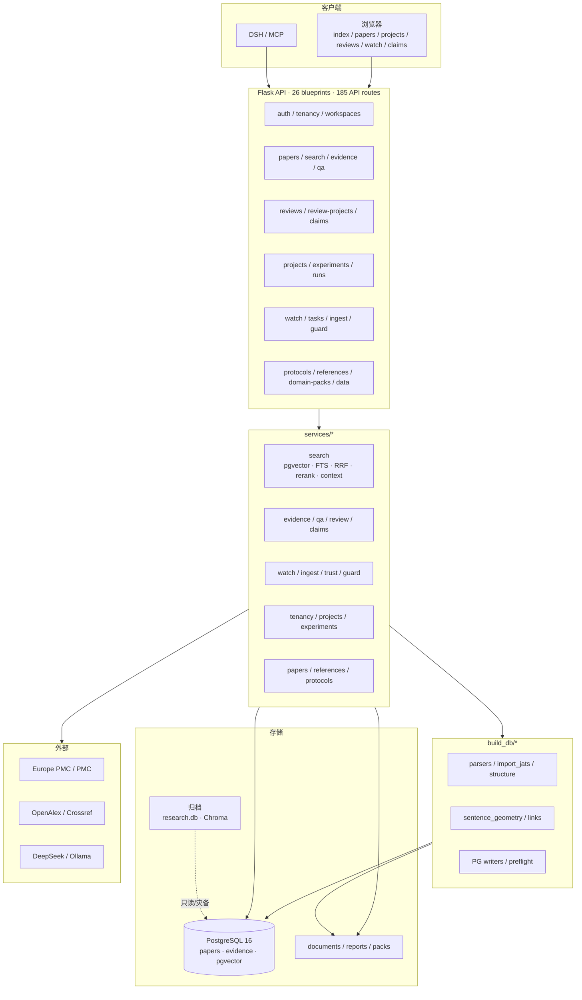
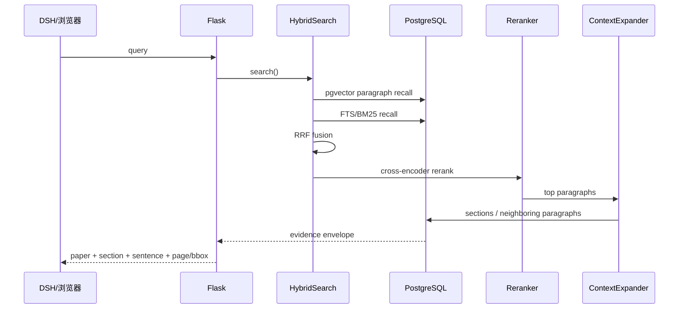

# SciPal 架构与路由图

> 版本：2026-11-08 · PG-only  
> 技术栈：Python 3.12 · Flask 3 · PostgreSQL 16 + pgvector · 原生 HTML/JS  
> 部署：Docker Compose（app + watch-cron + Caddy + PostgreSQL）

> 配套文档：[开发-模块手册](开发-模块手册.md) · [PG-only 总报告](PG-only迁移总报告-2026-11-08.md) · [机器架构](../ARCHITECTURE.json)

---

## 1. 设计原则

```text
确定性检索
  -> 结构化证据
    -> claim 审讯
      -> 受约束写作
```

四条底线：

1. **检索可追溯**：段落、句子、图、表都能回到 `paper_id / section / page / bbox`。
2. **claim 有证据**：claim 必须绑定精确 quote。
3. **裁决可审计**：状态变化写入事件表，不覆盖历史。
4. **单轨存储**：生产只读写 PostgreSQL；SQLite / Chroma 仅作归档，不在运行路径。

---

## 2. 系统分层



运行规模：

```text
26 个已注册蓝图
185 条 API 路由
108 条 GET 路由
10 个前端页面
```

---

## 3. 存储分层

### 3.1 主库

```text
PostgreSQL 16 / scipal_bench
  SCIPAL_PG_DSN
```

核心表：

```text
papers / sections / paragraphs / sentences
citations / figures / tables / sentence_links
paragraph_embeddings（pgvector）
summaries / abstracts
reviews / claim_cards / claim_card_evidence / claim_card_events
projects / project_members / experiments / experiment_runs
experiment_revisions / experiment_signatures / experiment_access_requests
tasks / watch_profiles / watch_runs / watch_items
users / workspaces / memberships / tenancy_audit
```

### 3.2 向量

```text
表       paragraph_embeddings
索引     HNSW
向量     320,928
维度     768
索引大小 1.235 GB
参数     m=16, ef_construction=100
```

检索路径：

```text
query embedding
  -> pgvector HNSW recall
  -> JOIN papers（duplicate_of IS NULL）
  -> RRF + reranker
```

### 3.3 文件

```text
documents/            PDF / XML / 补充材料
data/reports/         生成的报告
packs/                领域包
```

### 3.4 归档

```text
research.db   I:\_archive\research.db-20261107
Chroma        I:\_archive\chroma-20261107
```

生产不挂载 `research.db`，不初始化 Chroma。

---

## 4. 数据模型

### L0 文档树

```text
papers
 └─ sections
     └─ paragraphs
         ├─ sentences
         ├─ figures
         └─ tables
```

关键字段：

```text
paper_id / section_id / para_id / sentence_id
page / bbox / char_start / char_end
section_path / depth / parent_id
```

### L1 证据单元

```text
sentences        句子 + 偏移
figures / tables caption + markdown
sentence_links   句子 ↔ 引用/图/表
paper_links      cites / cited_by / similar
```

### L2 claim

```text
claim_cards
claim_card_evidence
claim_card_events
```

关系：

```text
supports | refutes | mentions | underdetermines
```

### L3 综述项目

```text
review_projects
review_project_papers
screening_decisions
adjudications
evidence_rows
risk_of_bias
review_webhooks
```

### L4 多用户 / 项目 / 实验

```text
users / workspaces / memberships
projects / project_members
experiments / experiment_runs
experiment_revisions / experiment_signatures
experiment_access_requests
```

---

## 5. 检索流程



关键行为：

```text
SCIPAL_VECTOR_BACKEND=pgvector
SCIPAL_FTS_BACKEND=postgres
SCIPAL_SEARCH_META_BACKEND=postgres
```

重复论文过滤：

```text
papers.duplicate_of IS NULL
```

覆盖检索、summary、evidence 三层。

---

## 6. 主要请求流

### 6.1 搜索

```text
GET/POST /api/search/hybrid
  -> HybridSearch
  -> pgvector + PG FTS
  -> RRF + rerank
  -> papers
```

### 6.2 证据包

```text
POST /api/evidence/search
  -> UnifiedRetriever
  -> parent_contexts
  -> duplicate filter
  -> sentence links
  -> paper flags
```

### 6.3 综述

```text
POST /api/review/generate
  -> outline
  -> section retrieval
  -> drafting
  -> citation verification
  -> reviews
```

系统综述：

```text
/api/review-projects
  -> screening
  -> PRISMA
  -> evidence
  -> risk of bias
  -> report / export
```

### 6.4 入库

```text
PMC IDs
  -> download
  -> parse
  -> preflight
  -> PostgreSQL write
  -> embedding backfill
```

### 6.5 项目 / 实验

```text
projects -> experiments -> runs
  -> revisions / audit / signatures
```

---

## 7. 路由分组

| 蓝图 | 前缀 | 职责 |
|---|---|---|
| `core`, `system` | `/api` | health、retrieve、graph、communities |
| `papers`, `papers_actions` | `/api/papers` | 列表、详情、解析、trace、补充材料 |
| `search`, `search_downloads` | `/api/search` | 混合检索、在线检索、下载 |
| `evidence`, `qa` | `/api/evidence`, `/api/qa` | 证据包、问答、校验 |
| `reviews`, `review_actions`, `review_projects` | `/api/reviews`, `/api/review*` | 综述生成、系统综述 |
| `projects` | `/api/projects` | 项目、成员 |
| `experiments`, `experiment_runs` | `/api/experiments`, `/api/runs` | 实验、运行、签名 |
| `claims` | `/api/claims` | claim cards、evidence、裁决 |
| `watch` | `/api/watch` | 监测 profile、run、digest |
| `tenancy` | `/api/auth`, `/api/workspaces` | 登录、工作区、隔离 |
| `notes` | `/api/notes` | 论文笔记 |
| `tasks`, `ingest` | `/api/tasks`, `/api/ingest` | 任务、入库 |
| `guard` | `/api/guard` | 术语校验 |
| `protocols` | `/api/protocols` | 实验协议 |
| `references` | `/api/references` | 参考文献 |
| `abstracts` | `/api/abstracts` | 摘要 |
| `domain_packs` | `/api/domain-packs` | 领域包 |
| `data` | `/api/data` | 本地表格画像/聚合 |

---

## 8. 运行配置

```text
SCIPAL_PG_DSN=postgresql://...
SCIPAL_VECTOR_BACKEND=pgvector
SCIPAL_FTS_BACKEND=postgres
SCIPAL_SEARCH_META_BACKEND=postgres
SCIPAL_SQLITE_QUERY_ONLY=1
SCIPAL_AUTH_REQUIRED=1
SCIPAL_SECRET_KEY=...
```

模块开关：

```text
SCIPAL_PROJECTS_BACKEND=postgres
SCIPAL_RUNS_BACKEND=postgres
SCIPAL_EXPERIMENTS_BACKEND=postgres
SCIPAL_REVIEWS_BACKEND=postgres
SCIPAL_SYSTEMATIC_BACKEND=postgres
SCIPAL_CLAIMS_BACKEND=postgres
SCIPAL_NOTES_BACKEND=postgres
SCIPAL_TASKS_BACKEND=postgres
SCIPAL_PAPERS_READ_BACKEND=postgres
SCIPAL_INGEST_PG_ONLY=1
```

---

## 9. 启动与故障

```text
启动
  -> 加载 env
  -> 注册 26 个蓝图
  -> SCIPAL_SQLITE_QUERY_ONLY=1 时跳过 SQLite schema/migration
  -> 首次请求加载 embedding/reranker
  -> /api/health
```

原则：

```text
PG 不可用 -> 主检索失败，不回退 SQLite
research.db 不存在 -> 正常启动
Chroma 不存在 -> 正常启动
```

---

## 10. 验证

```text
20 题回归        Recall@10 0.675 / nDCG@10 0.461
SciFact 300      Recall@10 0.8669 / nDCG@10 0.7458
全站分层烟测      50 条 / 0 个 5xx
research.db      absent
```
