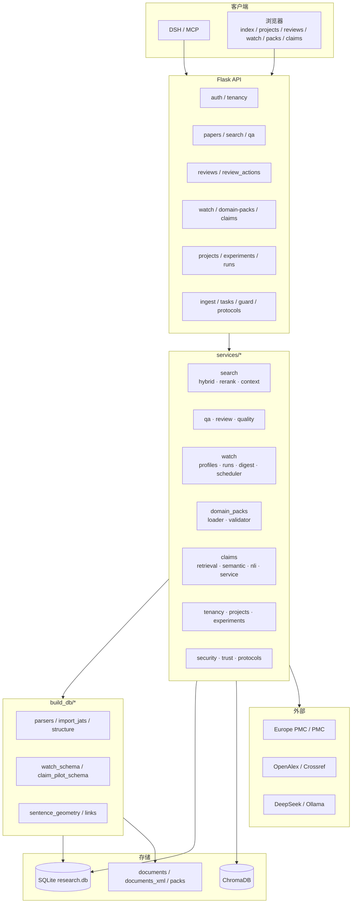
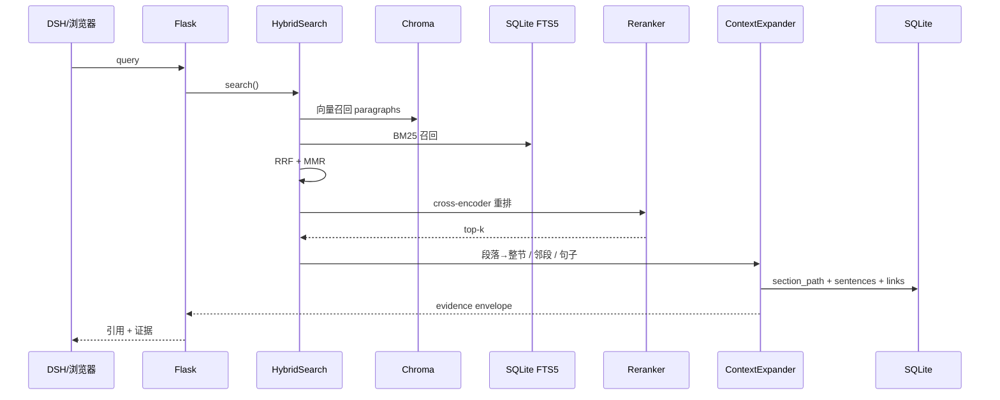
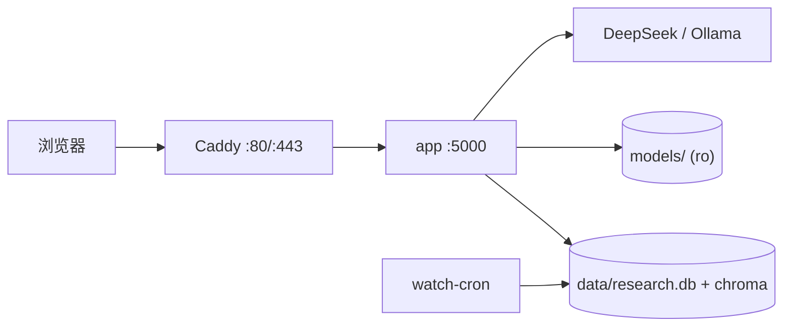

# SciPal 架构与路由图

> 版本：V33.96+（2026-10-31）  
> 代码：Flask + SQLite + ChromaDB + 原生 HTML/JS  
> 部署：Docker Compose（app + watch-cron + Caddy）
>
> ⚠️ 项目处于重度开发阶段（WIP），禁止直接用于生产环境。详见根目录 README。

---

## 1. 设计原则

```text
确定性检索
  ↓
结构化证据
  ↓
claim 审讯
  ↓
受约束写作
```

三条底线：

1. **检索可追溯**：每个段落、句子、图、表都能回到 paper_id / section / page / bbox。
2. **claim 有证据**：claim 必须绑定精确 quote；没有证据不写断言。
3. **裁决可审计**：状态变化写入事件表，不覆盖历史。

---

## 2. 系统分层



当前规模：

```text
26 个已注册蓝图
约 180 条路由
9 个前端页面
683 项测试
```

---

## 3. 数据分层

### L0：文档树

```text
papers
 └─ sections
     └─ paragraphs
         ├─ sentences
         ├─ figures
         └─ tables
```

关键字段：

```text
paper_id / section_id / para_id / sentence_id
page / bbox / char_start / char_end
section_path / depth / parent_id
```

### L1：证据单元

- `sentences`：句子级文本 + 偏移；
- `figures` / `tables`：caption + markdown；
- `sentence_links`：句子 ↔ 引用/图/表；
- `paper_links`：cites / cited_by / similar。

### L2：claim

```text
claim_cards
claim_card_evidence
claim_card_events
```

`claim_cards`：

```text
claim_id
workspace_id
title / claim_text / claim_type
status
qualifiers_json
corpus_json
warrant / backing / rebuttal / strongest_counter
writing_brief
decision / decision_note / decided_by / decided_at
```

`claim_card_evidence`：

```text
claim_id
paper_id / node_type / node_id
relation: supports | refutes | mentions | underdetermines
strength / quote / rationale
```

### L3：watch

```text
watch_profiles
watch_profile_journals
watch_runs
watch_items
watch_seen
```

### L4：多用户 / 项目

```text
users / workspaces / memberships / tenancy_audit
projects / project_members
experiments / experiment_runs / experiment_revisions
experiment_signatures / experiment_access_requests
```

---

## 4. 检索流程



关键修复：

```text
Chroma $in 必须收到 list，不是 set
→ chroma_paper_filter()
```

---

## 5. Claim 审讯流程

```text
主题 / 论文
  ↓
claim 抽取 / 人工写入
  ↓
qualifiers
  ↓
支持 / 反对 / 边界检索
  ↓
NLI: supports / refutes / mentions / underdetermines
  ↓
人工裁决
  ↓
writing_brief
  ↓
写作闸门
```

状态机：

```text
draft
  ↓
interrogating
  ↓
supported / contested / underdetermined
  ↓
accepted / revised / contested / rejected
```

当前状态分布：

```text
accepted: 3
revised: 3
contested: 2
underdetermined: 2
```

关键 claim：

```text
claim_hcc_triple_os
accepted → contested
refutes: LEAP-012 / EMERALD-1 OS 未成熟
writing_brief: PFS 可写，OS 不可写显著获益
```

---

## 6. Watch 流程

```text
profile
  ↓
discover journals / Crossref
  ↓
window search
  ↓
dedup
  ↓
score: profile match + journal metric + recency
  ↓
select: max_items + same_journal_limit
  ↓
ingest abstract / fulltext
  ↓
digest
  ↓
feedback: useful / not_useful
```

调度：

```text
services/watch/scheduler.py
scripts/run_watch_due.py
docker compose service: watch-cron
每 5 分钟检查 next_run_at
```

---

## 7. 领域包

```text
packs/biomed-oncoimmuno/
├─ pack.yaml
├─ taxonomy.yaml
├─ section_types.yaml
├─ evidence_schema.yaml
├─ sources.yaml
├─ prompts/
├─ eval/claims_pilot.yaml
├─ eval/claim_counterexamples.yaml
└─ README.md
```

加载：

```text
services/domain_packs/loader.py
GET /api/domain-packs
GET /api/domain-packs/<id>
GET /api/domain-packs/<id>/validate
```

原则：

- 核心不 import 具体领域包；
- 声明式优先；
- Python 钩子后置；
- 未签名/未校验包不进入生产。

---

## 8. 部署拓扑



服务：

```text
app         Flask + Gunicorn/开发服务器
watch-cron  到期 profile 调度
caddy       反向代理
```

数据路径：

```text
G:\sciPal_deploy\
├─ data/
├─ documents/
├─ documents_xml/
├─ models/
└─ logs/
```

---

## 9. 鉴权与隔离

```text
session user_id
  ↓
workspace_id
  ↓
role: owner | pi | member | viewer
  ↓
authorize()
```

隔离点：

- papers / notes / favorites / projects / experiments；
- 检索：`allowed_paper_ids()` → `filters["paper_ids"]`；
- QA：跨 workspace 的 paper_id → 404；
- watch：owner 级隔离；
- PI：只读/复制，不可修改他人实验；实验需 owner 批准。

`SCIPAL_AUTH_REQUIRED` 默认关闭，兼容单用户本地使用。

---

## 10. 路由分组

| 组 | 前缀 |
|---|---|
| 认证 / 工作区 | `/api/auth/*` `/api/workspaces/*` |
| 检索 | `/api/retrieve` `/api/search/*` |
| 论文 | `/api/papers/*` |
| 问答 | `/api/qa/*` `/api/agentic/*` |
| 综述 | `/api/review/*` `/api/reviews/*` |
| 文献监控 | `/api/watch/*` |
| 领域包 | `/api/domain-packs/*` |
| Claim | `/api/claims/*` |
| 项目 / 实验 | `/api/projects/*` `/api/experiments/*` `/api/runs/*` |
| 入库 / 任务 | `/api/ingest/*` `/api/tasks/*` |
| 质量 / 协议 | `/api/guard/*` `/api/protocols/*` |

完整路由以 `routes/` 与 `api_server.py` 为准。

---

## 11. 前端页面

| 页面 | 作用 |
|---|---|
| `index.html` | 首页 |
| `login.html` | 登录 |
| `projects.html` | 项目 / 实验 / run / 审计 / 签名 |
| `reviews.html` | 综述大纲 / 生成 / 历史 |
| `watch.html` | 监控 profile / 周报 / 反馈 |
| `packs.html` | 领域包查看 / 校验 |
| `claims.html` | Claim Card / 证据 / 裁决 / 写作口径 |
| `trace.html` | 句子溯源 |
| `compare.html` | 双栏对比 |
| `viewer.html` | PDF 阅读 |

---

## 12. 测试与边界

```text
683 项测试
~60s
```

覆盖：

- 检索 / 路由 / guard；
- JATS 导入 / sentences；
- watch / scheduler / feedback；
- domain packs；
- claim card / evidence / decision / writing brief；
- 多用户隔离 / 项目 / 实验 / run。

### 止损守卫

```text
services/quality/stop_loss.py
scripts/run_tests_guarded.py
scripts/record_eval_metric.py
logs/stop_loss_state.json
```

规则：

- 同一个测试连续 2 次失败 → 退出码 2；
- 同一个指标连续 2 次未提升 → 退出码 2；
- 输出：`触发止损规则，停止调参，等待人类介入`。

### 插件端口（M0）

```text
plugins/manifests/*.yaml   身份 / 版本 / entrypoint / license
plugins/ports/*.json       core-owned input/output schema
plugins/adapters/*.py      adapter.run(payload) -> dict
services/plugins/          contracts / registry / runner
eval/plugin_bench.py       统一对比入口
logs/plugin_runs.jsonl     每次调用的 provenance
```

约束：

- 插件不直接写 DB；
- 输入/输出过 JSON Schema；
- 每次调用记录 `plugin_id/version/dataset_hash/latency`；
- M0 为可信本地插件进程内执行，隔离属于后续阶段。

当前限制：

1. Claim 试点只覆盖 10 个 HCC claim；不是通用 claim 抽取。
2. 反例检索仍受本地语料限制；在线导入只完成 2 篇。
3. 写作闸门仍是 brief + 人工检查，不是自动拒绝生成。
4. SQLite 单节点；多用户规模有限。
5. 私有数据上云需要额外路由/合规控制。
