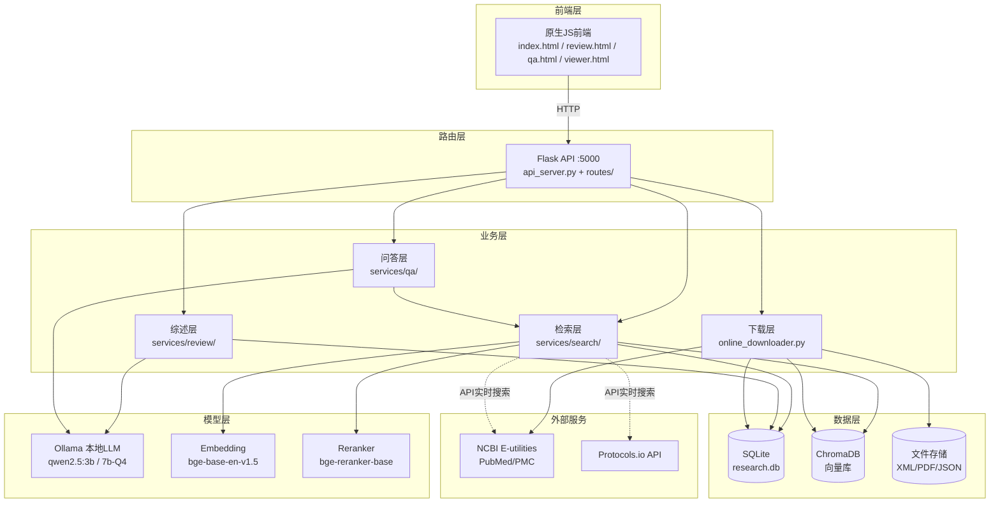
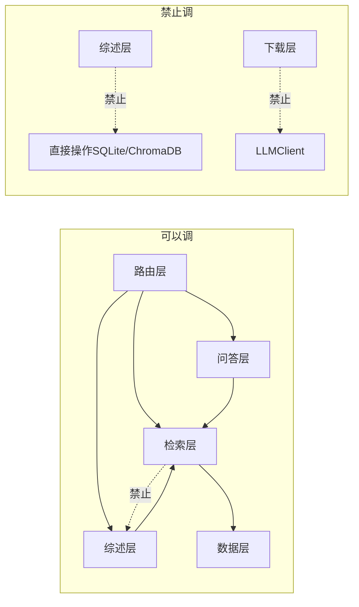

# 架构总览

> 本文件是"上帝视角"——先看这张图，再看模块说明，最后查接口明细。
> 给人看，也给 AI 看。每次新对话前先读这个文件。

## 环境约束（顶层设计，不可违反）

- **目标系统**：Windows 10/11，Python 3.12（venv: `venv_sciPal_py312`）
- **路径处理**：统一使用 `pathlib.Path`，禁止硬编码 `/` 或 `\`
- **禁止使用**：`chmod`、`apt-get`、`kill`、`ps`、`grep` 等 Linux 命令；`fcntl`、`resource`、`pwd` 等 Linux 库
- **控制台编码**：入口脚本必须加 `sys.stdout.reconfigure(encoding='utf-8')`
- **数据库**：SQLite + ChromaDB（嵌入式），不需要 MySQL/PostgreSQL
- **LLM**：Ollama 本地服务 `http://localhost:11434`

## 整体大图



> ⚠️ **注意**：本项目运行在 Windows 环境，路径处理必须跨系统兼容。
> 所有文件路径用 `pathlib.Path` 拼接，禁止硬编码分隔符。

## 模块职责（一句话版）

### 前端层
| 模块 | 干什么 |
|------|--------|
| `frontend/index.html` | 搜索主页：输入关键词，混合搜索本地+在线论文 |
| `frontend/review.html` | 综述生成页：选大纲→分配论文→逐章生成 |
| `frontend/qa.html` | 问答页：RAG 学术问答 |
| `frontend/viewer.html` | PDF 阅读器：看原文、标注 |

### 路由层
| 模块 | 干什么 |
|------|--------|
| `api_server.py` | Flask 主入口，所有 API 路由的注册中心 |
| `routes/` | 按业务拆分的路由文件（search/paper/ai/writing） |

### 业务层
| 模块 | 干什么 | 一句话 |
|------|--------|--------|
| **检索层** `services/search/` | 从各种来源找论文 | 本地向量+FTS、NCBI在线、Protocols.io方法 |
| **综述层** `services/review/` | 生成综述 | 检索证据→LLM写稿→评审→自动引用 |
| **问答层** `services/qa/` | 回答问题 | 检索相关段落→LLM生成答案→解析引用 |
| **下载层** `online_downloader.py` | 异步下载新论文 | 后台线程下载PMC XML→入库→建索引 |

### 模型层
| 模块 | 干什么 |
|------|--------|
| `LLMClient` | 统一封装 Ollama 调用，支持 chat 和 chat_json |
| `Embedding` | 文本转向量（bge-base-en-v1.5） |
| `Reranker` | Cross-Encoder 精排（bge-reranker-base） |

### 数据层
| 存储 | 存什么 |
|------|--------|
| SQLite `data/research.db` | 论文元数据、章节、段落、图表、证据卡片 |
| ChromaDB `data/chroma/` | 全文段落向量 |
| ChromaDB `data/chroma_abstracts/` | 摘要向量 |
| 文件 `documents_xml/` | PMC 全文 XML |

## 模块边界（绝对不能跨的线）



| 禁止行为 | 原因 |
|----------|------|
| 综述层直接写 SQLite/ChromaDB | 必须通过检索层，保证检索逻辑统一 |
| 问答层直接用 EvidenceExtractor | 问答有自己的证据链路，不混用 |
| 下载层调用 LLMClient | 下载只取数据，不做 AI 推理 |
| 检索层调用 ReviewGenerator | 检索是被调方，不能反向依赖业务层 |
| 任何模块直接读写 `data/*.db` | 必须通过 DAO 层 |
| 前端直连 NCBI/Protocols.io | 必须通过后端代理，保护 API Key |

## 数据流总览

```
用户输入 → 路由层 → 业务层（检索/综述/问答）→ 数据层（SQLite+ChromaDB）
                          ↓
                    外部服务（NCBI/Protocols.io）
```

详细的逐函数说明见 [接口明细.md](接口明细.md)。
