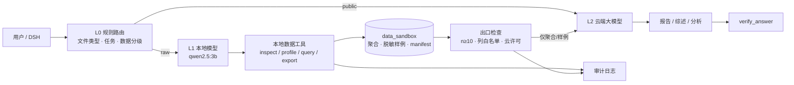

# 计划书：模型分层与原始数据隔离

> 状态：P1/P2/P4 核心已实现（2026-10-28）

## 实现状态

| 阶段 | 状态 |
|---|---|
| P1 data_sandbox 目录 + manifest + inspect/profile/validate | ✅ |
| P2 聚合 n≥10 + 样例脱敏 + cloud_gate | ✅ |
| P3 DSH 会话模板 + 小模型调度配置 | ✅ 文档 docs/DSH-模型分层配置.md（路由策略在 SciPal） |
| P4 串行模型管理器 + 审计 | ✅ services/model_serial.py；data_audit 元数据审计 + E2E 演练 |
> 目标：小模型本地调度、大模型云端推理；原始数据（Excel/CSV/TSV/DOCX…）不出本地，
> 云端只接收聚合统计与脱敏样例；本地提供可编辑的聚合/脱敏目录；模型串行加载。

## 0. 决策摘要

| 决策 | 内容 |
|---|---|
| 模型分层 | L0 规则路由 → L1 本地小模型调度 → L2 云端大模型分析/写作 |
| 数据隔离 | raw 会话只挂本地工具；云端工具不注册 |
| 云端可见 | 聚合统计 + 脱敏样例（用户确认允许） |
| 最小聚合阈值 | 任何聚合/样例的计数 `n ≥ 10`，小格抑制 |
| 本地目录 | 可编辑的 `data_sandbox/<owner>/<project>/`，manifest 管版本与云许可 |
| 模型加载 | 串行：同一时刻只加载一个模型，队列 + 锁 |
| 审计 | 记录数据指纹、模型、字节数；不记录原始内容 |

## 1. 目标与非目标

### 目标

1. 让 3B 级本地模型可靠地调度插件/工具，而不是让它做分析；
2. 云端大模型只处理“可公开的文献”和“本地生成的聚合/脱敏产物”；
3. 原始文件、原始行、未脱敏列值永不进入云端请求；
4. 聚合与脱敏结果可人工编辑、版本化、可追溯；
5. 单卡 8GB 环境下模型串行加载不爆显存。

### 非目标

- 不做多租户计费/配额（owner 已有，配额后续）；
- 不承诺 3B 模型零错误，靠 schema 校验与规则兜底；
- 不做自动“数据脱敏合规认证”，只做工程隔离。

## 2. 总体架构



## 3. 数据分级与策略矩阵

| 级别 | 示例 | 可用模型 | 可用工具 | 云端 |
|---|---|---|---|---|
| `raw` | xlsx / csv / tsv / docx / 原始数据库导出 | 仅本地 | `data_*` | 禁止 |
| `derived` | profile、聚合表、脱敏样例 | 本地或云端 | `artifact_*` | 需 `cloud_eligible=true` |
| `public` | 论文、摘要、公开文本 | 本地或云端 | `search_*` / `evidence_*` | 允许 |
| `mixed` | 原始数据 + 文献 | 本地准备 → 云端综合 | 分阶段切换 | 仅 derived 部分 |

策略由**会话创建时绑定**，不允许中途提升权限；切换必须新建会话。

## 4. 模型分层与串行调度

### 4.1 模型角色

| 角色 | 模型 | 用途 | 约束 |
|---|---|---|---|
| router | 规则 + JSON Schema | 意图、工具选择、参数校验 | 无模型 |
| orchestrator | qwen2.5:3b（Ollama） | 多步调度、填参、重试 | 只输出工具调用 |
| data_local | qwen2.5:7b（可选） | 本地数据解释、字段映射 | 不接触云端 |
| analyst | 云端大模型 | 跨文档推理、写作 | 只收 derived/public |
| verifier | 规则 + guard | 引用、冲突、实体校验 | 无模型 |

### 4.2 串行加载状态机

```
IDLE → LOADING(model) → READY(model) → RELEASING → IDLE
```

- 全局 `model_lock`（文件锁/进程锁），同一时刻只有一个模型驻留；
- Ollama `keep_alive=0`，用完立即释放；
- 队列按优先级：交互请求 > 批处理 > 定时任务；
- 估算显存：3B ≈ 2GB，7B-Q4 ≈ 4.5GB，embedding/reranker 另算；
- 超时与降级：加载失败 → 回退规则路由；云端不可用 → 本地降级并标注。

### 4.3 DSH 配置

```
默认模型：云端大模型
本地模型：qwen2.5:3b（orchestrator）
任务模板：
  数据准备阶段  → 本地模型
  综合分析阶段  → 云端模型
  MCP：
    scipal-data  仅本地，raw 会话才挂载
    scipal-search / scipal-evidence  公共文献
```

## 5. 本地聚合/脱敏目录系统

### 5.1 目录布局

```
data_sandbox/
└─ <owner>/
   └─ <project_id>/
      ├─ manifest.json              # 项目级索引（可编辑）
      ├─ profile/<artifact_id>.json # 列统计、dtype、缺失率
      ├─ aggregates/<artifact_id>.csv
      ├─ samples/<artifact_id>.csv  # 脱敏样例，≤5 行
      ├─ reports/<artifact_id>.md
      └─ audit.log                  # 仅元数据，不含原值
```

### 5.2 manifest 结构

```json
{
  "project_id": "proj_20261028_001",
  "owner": "alice",
  "source": {
    "filename_hash": "sha256:...",
    "rows": 12000,
    "columns": 18,
    "ingested_at": "2026-10-28T08:00:00+08:00"
  },
  "policy": {
    "min_agg_n": 10,
    "cloud_eligible": true,
    "allowed_columns": ["age_group", "sex", "stage"],
    "redactions": ["name", "id", "phone", "address"]
  },
  "artifacts": [
    {
      "id": "agg_001",
      "kind": "aggregate",
      "path": "aggregates/agg_001.csv",
      "rows": 24,
      "min_cell_n": 12,
      "cloud_eligible": true,
      "created_by": "data_profile",
      "created_at": "..."
    }
  ]
}
```

### 5.3 可编辑方式

- **DSH 工具**：`artifact_list`、`artifact_read`、`artifact_update`、`artifact_validate`；
- **文件系统**：直接编辑 CSV/JSON，重新运行 `artifact_validate` 更新索引；
- 编辑后必须通过校验：列白名单、n≥10、无原始列、无自由文本 PII；
- 版本：每次编辑生成 `artifact_id_v2`，manifest 保留历史，不覆盖。

### 5.4 索引表（可选）

```sql
data_artifacts(
  id, owner, project_id, kind, path, sha256,
  rows, min_cell_n, cloud_eligible, created_by, created_at
)
```

用于快速检索与审计；文件仍是事实来源。

## 6. 工具契约（MCP）

### 6.1 本地数据工具（raw 会话）

```
data_inspect(path) -> {sheets, rows, columns, dtypes}
data_profile(path, sheet="") -> {columns:[{name,dtype,missing,unique}], n}
data_query(path, sql|filters, group_by) -> 聚合结果（强制 n≥10）
data_sample(path, columns, rows<=5) -> 脱敏样例（列白名单）
data_export(profile|aggregate, artifact_id) -> 写入 data_sandbox
```

### 6.2 产物工具（derived 会话）

```
artifact_list(project_id)
artifact_read(artifact_id)
artifact_update(artifact_id, content)   # 允许人工修正
artifact_validate(artifact_id)          # 重新校验
```

### 6.3 出口检查

```
cloud_gate(artifact_id, target_provider) -> allow | deny(reason)
```

规则：

1. `cloud_eligible=true`；
2. `min_cell_n ≥ 10`；
3. 列名在 allowlist；
4. 无原始行、无文件路径、无 PII；
5. 目标 provider 在允许列表。

## 7. 工作流

### 7.1 raw 会话（Excel 分析）

```
1. 用户上传 Excel → L0 判定 raw
2. 仅挂载 data_* 工具（云端工具不注册）
3. L1 本地模型：data_inspect → data_profile
4. 本地生成 profile/aggregate/sample → data_sandbox
5. artifact_validate → cloud_eligible
6. 用户确认“允许云端分析”
7. 云端 L2 只收到 DataProfile + 聚合表
8. 云端写报告 → verify_answer
```

### 7.2 公共文献会话

```
L0 → public → 云端模型 + SciPal 证据包（search_evidence）
→ 生成 → verify_answer → 正式/草稿
```

### 7.3 混合会话

```
阶段 A（本地）：数据准备，产出 derived 产物
阶段 B（云端）：仅 derived + public 文献
```

## 8. 安全不变量

1. raw 会话的可用工具集合中**不存在**云端/检索工具；
2. 任何云端请求的 payload 必须来自 `cloud_gate=allow` 的产物；
3. 聚合表最小计数 `n≥10`，`1..9` 一律抑制/合并；
4. 样例最多 5 行，且只含 allowlist 列；
5. 文件路径、原始行、sheet 名不得进入云端 prompt；
6. 审计只记指纹与元数据，不记原值；
7. 数据 worker 默认无外网，出网只经网关。

## 9. 配置清单

```
# 模型
SCIPAL_MODEL_SERIAL=1
OLLAMA_HOST=http://127.0.0.1:11434
SCIPAL_ORCHESTRATOR_MODEL=qwen2.5:3b
SCIPAL_DATA_MODEL=qwen2.5:7b

# 数据隔离
SCIPAL_DATA_ROOT=D:\sciPal\data_sandbox
SCIPAL_MIN_AGG_N=10
SCIPAL_MAX_SAMPLE_ROWS=5
SCIPAL_ALLOW_CLOUD_AGGREGATES=1
SCIPAL_CLOUD_PROVIDERS=deepseek,openai
SCIPAL_DATA_EGRESS=gateway-only

# 鉴权
SCIPAL_API_TOKENS={"tok":"owner"}
```

DSH 侧：每个会话模板绑定模型与 MCP 集合；raw 模板不挂 `scipal-search`。

## 10. 失败处理

| 场景 | 处理 |
|---|---|
| 小模型参数不合法 | schema 校验失败 → 规则重试 → 转人工 |
| 本地模型加载失败 | 回退规则路由；标注“未使用模型” |
| 云端不可用 | 本地摘要 + 标记“草稿” |
| 聚合不满足 n≥10 | 提高分组粒度或抑制，不出表 |
| 产物校验失败 | 禁止 cloud_gate，提示修正 |
| 模型切换超时 | 队列等待，超时降级 |

## 11. 验收标准

1. raw 会话的 MCP 工具列表中无任何云端/检索工具（自动化断言）；
2. 100% 云端请求 payload 通过 `cloud_gate`（日志抽样）；
3. 聚合结果中不存在 `0<n<10` 的单元格（随机抽检）；
4. 样例 ≤5 行且无禁用列；
5. 模型串行：并发请求下 GPU 峰值显存不超过单模型上限；
6. 人工编辑产物后，`artifact_validate` 能正确更新索引；
7. 审计日志可还原“谁在何时把哪个产物发给了哪个 provider”。

## 12. 分阶段

| 阶段 | 内容 |
|---|---|
| P1 | `data_sandbox` 目录 + manifest + inspect/profile/validate |
| P2 | 聚合 n≥10 + 样例脱敏 + cloud_gate |
| P3 | DSH 会话模板（raw/public/mixed）+ 小模型调度 |
| P4 | 串行模型管理器 + 审计 + 端到端演练 |

## 13. 风险与开放问题

1. 小模型多步调度稳定性：以规则为主、模型为辅；
2. 聚合仍可能反推个体（k-匿名不足）：n≥10 只是下限，敏感字段需额外泛化；
3. 用户直接粘贴原始数据到聊天：需 UI 附件分类与拦截；
4. 云端 provider 日志策略：优先选可关闭日志的 provider；
5. 目录可编辑带来一致性风险：编辑后必须 validate，manifest 为准；
6. 8GB 显存下 embedding/reranker 与 LLM 的排队策略需实测。

## 14. 待确认

1. `data_sandbox` 是否按 owner 分目录（建议是）；
2. 产物人工编辑后是否允许直接覆盖，还是强制新版本（建议新版本）；
3. raw 会话是否允许“用户显式勾选后上传聚合表”（建议允许，需二次确认）；
4. 云端 provider 白名单最终名单。
