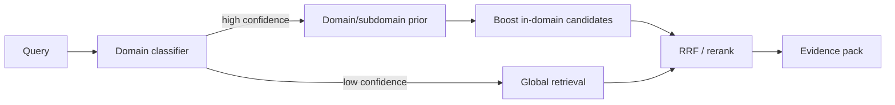

# 领域覆盖、领域感知路由与主题级惩罚讨论书

> **Status**: discussion draft, not an implementation decision  
> **Date**: 2026-11-01  
> **Scope**: corpus domain distribution, retrieval coverage ceilings, hubness, domain-aware routing, topic-level penalties  
> **Related**: [Retrieval SLO design](设计-检索SLO与冗余控制.md), [Document-bias audit](检索-文档级偏置审计.md), [HybridSearch bias audit](检索-HybridSearch偏置审计.md)

---

## 1. 问题背景

当前 SciPal 的检索评估主要建立在约 3,300 篇论文和 20 个查询上。

一个尚未被量化的结构性问题是：

```text
语料覆盖 5 个大领域、几十个小领域
论文在领域间分布极不均匀
长尾小领域只有几篇论文
```

这会导致两种完全不同的现象：

```text
A. 覆盖度上限：该领域本来就没有足够的相关论文
B. Hubness：有足够论文，但 top10 总被少数综述/高频论文占据
```

如果不区分 A 和 B，就会把“语料不足”误判为“检索失败”，或者把“排序偏置”误判为“领域太小”。

本文讨论这两种效应、需要的审计指标，以及可能采用的领域感知路由和主题级惩罚。

---

## 2. 两种效应的定义

### 2.1 覆盖度上限（coverage ceiling）

若某个查询在语料中只有 `N_rel` 篇相关论文，则：

```text
coverage_ceiling@10 = min(1, N_rel / 10)
```

例如：

```text
N_rel = 3   -> ceiling = 0.30
N_rel = 30  -> ceiling = 1.00
```

此时直接比较 Recall@10 是不公平的：

```text
sparse domain: Recall 0.30, ceiling 0.30  -> 已到上限
dense domain:  Recall 0.60, ceiling 1.00  -> 仍有排序问题
```

### 2.2 Hubness（枢纽论文偏置）

若某领域有足够论文，但 top10 反复出现同一批：

```text
综述
Meta 分析
高被引原始研究
```

则问题是排序，而不是覆盖。

Hub paper 的典型特征：

```text
term 覆盖广
段落多
向量中心性强
在多个 query 的 top10 中重复出现
```

---

## 3. 为什么领域分布会影响召回

### 3.1 稀疏领域

```text
query 落在长尾小领域
-> 相关论文只有几篇
-> top10 必须混入不相关论文
-> 看起来召回差
```

这不是单纯靠调 BM25 / reranker 能解决的。

### 3.2 密集领域

```text
query 落在大领域
-> 候选多
-> 高频论文/综述更容易被多路召回
-> top10 同质化
```

这属于 hubness 与文档级偏置。

### 3.3 当前评估的盲区

当前 20-query 集：

```text
每个 source 5 个 query
gold 基本是单篇论文
没有 domain 标签
没有 available_relevant_count
```

因此无法回答：

```text
这个 query 的语料上限是多少？
返回的 10 篇里有多少是真正不同的贡献？
同一篇论文在多少个 query 中反复出现？
```

---

## 4. 需要的审计指标

### 4.1 语料侧

```text
papers_per_subdomain
singleton_subdomain_rate
domain_entropy
gini_coefficient
```

### 4.2 查询侧

```text
query_domain_l1
query_domain_l2
available_relevant_count
coverage_ceiling@10
```

### 4.3 结果侧

```text
distinct_papers@10
hub_paper_rate
new_paper_rate
domain_entropy@10
```

### 4.4 调整后的召回

```text
Recall@10
Recall@10 / coverage_ceiling
```

建议同时报告原始值与 ceiling-adjusted 值。

---

## 5. 领域感知路由（Domain-Aware Routing）

### 5.1 目标

```text
让查询进入正确的领域/子领域
提高该领域的召回与排序优先级
同时不破坏 cross-topic 查询
```

### 5.2 设计原则

```text
软路由，不硬过滤
低置信度回退到全局
多标签领域允许交叉
```

### 5.3 路由流程



### 5.4 路由信号

```text
query 关键词
实体类型
期刊/来源
用户 workspace 的 domain pack
历史 query 领域
```

### 5.5 路由方式

只做 **boost**，不做硬过滤：

```text
in-domain candidate: score * (1 + alpha * domain_prior)
out-of-domain candidate: 保留，但不 boost
```

避免：

```text
硬 filter 导致 cross-topic 查询完全丢召回
```

### 5.6 置信度与回退

```text
confidence >= high_threshold  -> 启用 domain boost
confidence <  high_threshold  -> 全局检索
多标签冲突                    -> 全局 + 多领域轻微 boost
```

具体阈值需要用标注集校准，本文不预设数值。

---

## 6. 主题级惩罚（Topic-Level Penalty）

### 6.1 目标

不是惩罚“某篇论文”，而是惩罚：

```text
同一主题在结果中占比过高
同一论文/同一主题簇反复占据 top10
```

### 6.2 可选的惩罚层级

```text
paper-level:   同一 paper 的多个 chunk
topic-level:   同一 topic cluster / subdomain 的多个 paper
query-level:   同一 paper 在多个 query 中反复出现
```

### 6.3 候选公式

#### 方式 A：MMR 风格

```text
score = lambda * relevance
      - (1 - lambda) * max_similarity_to_selected
```

适合：

```text
同一论文多个相似段落
同一主题多个近似段落
```

#### 方式 B：主题占比惩罚

```text
adjusted_score = score * (1 - beta * topic_share_in_selected)
```

其中：

```text
topic_share_in_selected = 已选结果中该主题的占比
```

适合：

```text
同一 subdomain 占据 top10
```

#### 方式 C：论文重复惩罚

```text
adjusted_score = score * (1 - gamma * paper_share_in_topk)
```

适合：

```text
同一论文多段占位
```

### 6.4 保护性约束

```text
1. 至少保留每篇高相关论文的 1 个最佳证据
2. 不惩罚唯一相关论文
3. 只在存在替代主题时惩罚
4. 不能因为惩罚而丢掉 gold evidence
```

### 6.5 不建议的做法

```text
全局永久降低某篇论文的权重
硬性 max_per_paper=1
只按历史出现频率惩罚
```

原因：

```text
真正的基础综述可能应该反复出现
硬 cap 会删掉 gold sentence
历史频率不等于本次不相关
```

---

## 7. 建议的审计流程

### 第一步：领域标签

```text
paper_id
domain_l1
domain_l2
domain_l3
multi_label
source_of_label
```

来源：

```text
packs/<domain>/pack.yaml
期刊/关键词规则
人工抽样校正
```

### 第二步：查询分层

```text
dense:  available_relevant >= 30
medium: 10–29
sparse: < 10
```

每层至少 5 个 query，而不是只看全局 20 个。

### 第三步：同时报告

```text
Recall@10
Recall@10 / ceiling
distinct_papers@10
hub_paper_rate
domain_entropy@10
p95 latency
```

### 第四步：对照实验

```text
A. 全局 paragraph FTS（基线）
B. 全局 HybridSearch（修复 paper_id 后）
C. 全局 + near-dup
D. 全局 + domain boost
E. 全局 + topic penalty
F. domain boost + topic penalty
```

每个实验都必须同时看：

```text
覆盖率
句子级证据
延迟
```

---

## 8. 验收标准（建议）

```text
Recall@10 / ceiling 不低于基线
gold_sentence_recall@10 不低于基线
distinct_papers@10 提升
hub_paper_rate 下降
domain_entropy@10 提升
p95 延迟 <= 3s
```

注意：

```text
unique_papers 提升但 gold sentence 下降 -> 拒绝
hub_paper_rate 下降但 sparse domain 召回下降 -> 需要分层观察
```

---

## 9. 风险

```text
1. 领域分类器误判，导致 boost 错误领域
2. 硬过滤造成 cross-topic 查询丢召回
3. 主题惩罚误伤真正的综述/基础论文
4. 长尾领域标签太少，无法训练可靠分类器
5. 多标签领域边界模糊
6. 领域 boost 可能进一步放大热门领域
```

对应的保护：

```text
低置信度回退
软 boost
保留每篇最佳证据
分层评估
人工抽样复核
```

---

## 10. 开放问题

```text
1. 领域标签以 pack/manual 还是自动分类为主？
2. “主题”的粒度是 L2 子领域还是聚类簇？
3. topic penalty 是 query 内还是跨 query？
4. 是否允许用户指定 domain pack 作为强先验？
5. sparse domain 是否应该明确提示“证据有限”而不是凑满 10 篇？
```

---

## 11. 当前决策

```text
本文只是讨论书，不改变生产排序。
不立即实现 domain routing / topic penalty。
先做 domain coverage audit，确认 A（覆盖不足）与 B（hubness）的比例。
```

下一步：

```text
domain labels
-> stratified query set
-> ceiling-adjusted metrics
-> 再决定是否做 domain boost / topic penalty
```
