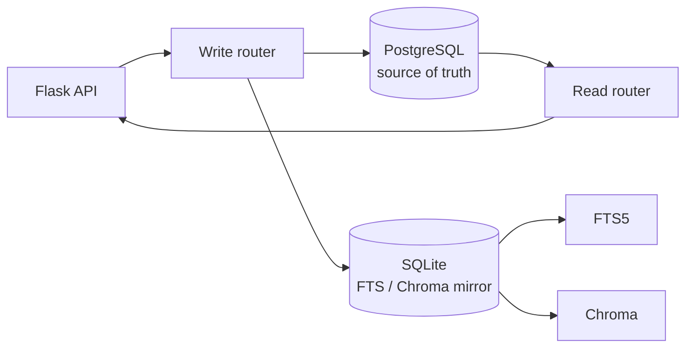

# PostgreSQL Write Path Productionization

> **Status**: design/inventory, implementation next  
> **Date**: 2026-11-02  
> **Goal**: make PostgreSQL the authoritative write path while keeping SQLite FTS/Chroma as derived search indexes.

---

## 1. Current State

```text
Reads:
  papers / detail / graph / tenancy  -> PostgreSQL
  FTS / vector                       -> SQLite FTS5 + Chroma

Writes:
  application routes                 -> SQLite
  SQLite triggers                    -> dual_write_outbox
  replay worker                      -> PostgreSQL
```

This is **SQLite-primary with asynchronous PG shadow**, not PG-primary.

The current design has three problems:

```text
1. PG can lag SQLite (outbox pending).
2. Two writers can disagree after a failed replay.
3. Direct SQLite readers remain in projects/experiments, so moving writes alone
   would create split-brain reads.
```

---

## 2. Write-Site Inventory

### 2.1 Tables with outbox triggers

```text
papers, sections, paragraphs, sentences, figures, tables, citations,
sentence_links, paper_links, claim_cards, claim_card_evidence,
claim_card_events, watch_items, watch_profiles, watch_runs, watch_seen,
users, workspaces, memberships, review_projects, review_events
```

### 2.2 Direct write sites found

```text
routes/papers_actions.py      UPDATE papers SET workspace_id
services/search/ingest.py     UPDATE papers / DELETE papers_fts
services/watch/runner.py      DELETE FROM papers
services/tenancy/service.py   INSERT users / workspaces / memberships
```

### 2.3 Direct SQLite readers that block a naive cutover

```text
services/projects/service.py       memberships role
services/experiments/service.py    memberships status/role
services/experiments/service.py    users.password_hash
```

These must be routed through the tenancy service (which can read PG) before
tenancy writes are cut over.

---

## 3. Target Architecture



Rules:

```text
1. PostgreSQL commit is authoritative.
2. SQLite is a derived index, not a second source of truth.
3. FTS tables stay SQLite-only.
4. Every migrated write is idempotent by primary key.
5. No route writes SQLite and PG independently without a shared transaction plan.
```

---

## 4. Options

### Option A: PG-primary + SQLite mirror (target)

```text
write PG
-> write SQLite mirror for FTS/Chroma
-> return
```

Pros:

```text
single source of truth
no outbox lag
```

Cons:

```text
requires SQLite mirror failure handling
requires all direct SQLite readers migrated
```

### Option B: synchronous replay bridge (short term)

```text
write SQLite
-> commit
-> replay this outbox row to PG before returning
```

Pros:

```text
small change
no reader migration
removes visible PG lag
```

Cons:

```text
still SQLite-primary
write latency includes PG
not the end state
```

### Option C: per-domain strangler (recommended execution)

```text
Phase 1 tenancy
Phase 2 papers metadata
Phase 3 watch
Phase 4 claims/reviews
```

Each phase:

```text
migrate readers
-> PG-primary writes
-> SQLite mirror
-> tests
-> remove outbox triggers for that domain
```

---

## 5. Recommended Sequence

### Phase 0: observability (this PR)

```text
outbox pending
oldest pending age
per-table replay failures
PG/SQLite row-count diff
```

### Phase 1: tenancy

```text
move projects/experiments membership reads to tenancy service
-> PG-primary create_user/create_workspace/add_member
-> SQLite mirror for legacy readers
-> tests
```

### Phase 2: papers metadata

```text
workspace_id assignment
ingest metadata updates
watch delete
```

### Phase 3: remove migrated triggers

```text
keep outbox for unmigrated tables only
```

---

## 6. Invariants

```text
- Every write has a stable primary key.
- PG upsert uses ON CONFLICT (pk) DO UPDATE.
- SQLite mirror is best-effort but must be repairable from PG.
- FTS is rebuilt from SQLite mirror, not written directly to PG.
- A failed mirror write must not roll back a committed PG write silently.
- A failed PG write must not leave a SQLite-only row for a migrated table.
```

---

## 7. Acceptance Gates

```text
1. After a write, PG row is visible before the response returns.
2. outbox pending for migrated tables = 0.
3. PG/SQLite row-count diff = 0 for migrated tables.
4. no direct SQLite query for migrated tenancy tables remains.
5. 759+ tests pass.
6. rollback path documented.
```

---

## 8. Risks

```text
- split-brain between PG and SQLite mirror
- unique/foreign-key drift
- audit table divergence
- long tail of direct SQLite reads
- write latency if synchronous replay is added
```

Mitigation:

```text
phase by domain
row-count/checksum checks
fail closed for PG-primary writes
keep outbox as repair log
```

---

## 10. Initial health check (2026-11-02)

Script: `scripts/pg_write_health.py`

```text
outbox pending                0
outbox failed_pending         0
```

But PG/SQLite row counts already differ:

| table | SQLite | PostgreSQL |
|---|---:|---:|
| papers | 3,310 | 3,312 |
| claim_card_events | 53 | 55 |
| watch_items | 11 | 13 |
| watch_runs | 5 | 7 |
| watch_seen | 11 | 13 |
| users | 1 | 2 |
| memberships | 1 | 2 |

This is important:

```text
PG is ahead of SQLite in several tables
outbox is empty
so the extra PG rows are not pending replay
```

Conclusion:

```text
Do not cut writes over until these differences are explained.
Some PG data may come from v2/scipal_bench or manual/admin operations.
```

The health report is stored at:

```text
eval/results/pg_write_health.json
```


## 9. Immediate Next Step

Before changing writes:

```text
1. add a write-path health report
2. migrate the three direct SQLite tenancy readers
3. implement PG-primary tenancy writes behind SCIPAL_TENANCY_WRITE_BACKEND=postgres
4. mirror to SQLite
5. verify with the existing tenancy tests plus an integration check
```

This avoids a big-bang cutover and keeps the search indexes working.
