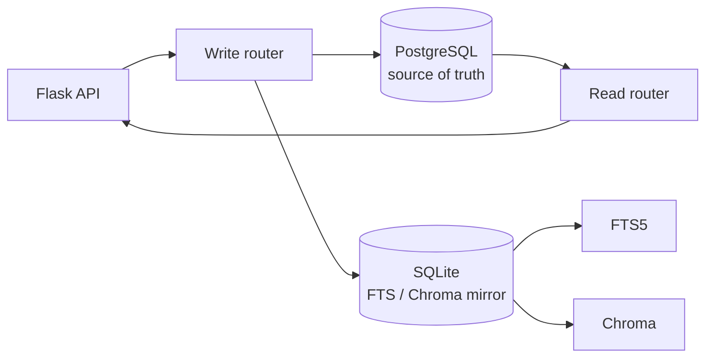

# PostgreSQL Write Path Productionization

> **Status**: design/inventory, implementation next  
> **Date**: 2026-11-02  
> **Goal**: make PostgreSQL the authoritative write path while keeping SQLite FTS/Chroma as derived search indexes.

---

## 1. Current State

```text
Reads:
  papers / detail / graph / tenancy  -> PostgreSQL
  FTS / vector                       -> SQLite FTS5 + Chroma

Writes:
  application routes                 -> SQLite
  SQLite triggers                    -> dual_write_outbox
  replay worker                      -> PostgreSQL
```

This is **SQLite-primary with asynchronous PG shadow**, not PG-primary.

The current design has three problems:

```text
1. PG can lag SQLite (outbox pending).
2. Two writers can disagree after a failed replay.
3. Direct SQLite readers remain in projects/experiments, so moving writes alone
   would create split-brain reads.
```

---

## 2. Write-Site Inventory

### 2.1 Tables with outbox triggers

```text
papers, sections, paragraphs, sentences, figures, tables, citations,
sentence_links, paper_links, claim_cards, claim_card_evidence,
claim_card_events, watch_items, watch_profiles, watch_runs, watch_seen,
users, workspaces, memberships, review_projects, review_events
```

### 2.2 Direct write sites found

```text
routes/papers_actions.py      UPDATE papers SET workspace_id
services/search/ingest.py     UPDATE papers / DELETE papers_fts
services/watch/runner.py      DELETE FROM papers
services/tenancy/service.py   INSERT users / workspaces / memberships
```

### 2.3 Direct SQLite readers that block a naive cutover

```text
services/projects/service.py       memberships role
services/experiments/service.py    memberships status/role
services/experiments/service.py    users.password_hash
```

These must be routed through the tenancy service (which can read PG) before
tenancy writes are cut over.

---

## 3. Target Architecture



Rules:

```text
1. PostgreSQL commit is authoritative.
2. SQLite is a derived index, not a second source of truth.
3. FTS tables stay SQLite-only.
4. Every migrated write is idempotent by primary key.
5. No route writes SQLite and PG independently without a shared transaction plan.
```

---

## 4. Options

### Option A: PG-primary + SQLite mirror (target)

```text
write PG
-> write SQLite mirror for FTS/Chroma
-> return
```

Pros:

```text
single source of truth
no outbox lag
```

Cons:

```text
requires SQLite mirror failure handling
requires all direct SQLite readers migrated
```

### Option B: synchronous replay bridge (short term)

```text
write SQLite
-> commit
-> replay this outbox row to PG before returning
```

Pros:

```text
small change
no reader migration
removes visible PG lag
```

Cons:

```text
still SQLite-primary
write latency includes PG
not the end state
```

### Option C: per-domain strangler (recommended execution)

```text
Phase 1 tenancy
Phase 2 papers metadata
Phase 3 watch
Phase 4 claims/reviews
```

Each phase:

```text
migrate readers
-> PG-primary writes
-> SQLite mirror
-> tests
-> remove outbox triggers for that domain
```

---

## 5. Recommended Sequence

### Phase 0: observability (this PR)

```text
outbox pending
oldest pending age
per-table replay failures
PG/SQLite row-count diff
```

### Phase 1: tenancy

```text
move projects/experiments membership reads to tenancy service
-> PG-primary create_user/create_workspace/add_member
-> SQLite mirror for legacy readers
-> tests
```

### Phase 2: papers metadata

```text
workspace_id assignment
ingest metadata updates
watch delete
```

### Phase 3: remove migrated triggers

```text
keep outbox for unmigrated tables only
```

---

## 6. Invariants

```text
- Every write has a stable primary key.
- PG upsert uses ON CONFLICT (pk) DO UPDATE.
- SQLite mirror is best-effort but must be repairable from PG.
- FTS is rebuilt from SQLite mirror, not written directly to PG.
- A failed mirror write must not roll back a committed PG write silently.
- A failed PG write must not leave a SQLite-only row for a migrated table.
```

---

## 7. Acceptance Gates

```text
1. After a write, PG row is visible before the response returns.
2. outbox pending for migrated tables = 0.
3. PG/SQLite row-count diff = 0 for migrated tables.
4. no direct SQLite query for migrated tenancy tables remains.
5. 759+ tests pass.
6. rollback path documented.
```

---

## 8. Risks

```text
- split-brain between PG and SQLite mirror
- unique/foreign-key drift
- audit table divergence
- long tail of direct SQLite reads
- write latency if synchronous replay is added
```

Mitigation:

```text
phase by domain
row-count/checksum checks
fail closed for PG-primary writes
keep outbox as repair log
```

---

## 10. Initial health check (2026-11-02)

Script: `scripts/pg_write_health.py`

### First check was invalid

The first run compared:

```text
local dev SQLite: D:\sciPal\data\research.db
production PG:    scipal_bench
```

That produced apparent PG-ahead differences in 7 tables. They were not
dual-write divergence; they were **different environments**.

### Correct comparison

Re-ran against the production SQLite copy:

```text
production SQLite: G:\sciPal_deploy\data\research.db
production PG:     scipal_bench
```

Result:

```text
outbox pending          0
outbox failed_pending   0
row-count diff          {}
```

All tracked tables match exactly, including:

```text
papers 3,312
users 2
memberships 2
watch_items 13
watch_runs 7
watch_seen 13
claim_card_events 55
```

Health report:

```text
eval/results/pg_write_health.json
```

### Conclusion

```text
No PG-ahead divergence.
No outbox lag.
The blocker was a measurement error, not a data problem.
```

## 9. Immediate Next Step

Before changing writes:

```text
1. add a write-path health report
2. migrate the three direct SQLite tenancy readers
3. implement PG-primary tenancy writes behind SCIPAL_TENANCY_WRITE_BACKEND=postgres
4. mirror to SQLite
5. verify with the existing tenancy tests plus an integration check
```

This avoids a big-bang cutover and keeps the search indexes working.

## 11. Phase 1 tenancy implementation (2026-11-02)

Implemented:

```text
services/tenancy/pg_writes.py
  create_user
  create_workspace
  add_member
  list_members

services/tenancy/service.py
  SCIPAL_TENANCY_WRITE_BACKEND=postgres
  PG-first write
  SQLite mirror for legacy readers
  fallback to SQLite on PG failure
```

Default remains SQLite:

```text
SCIPAL_TENANCY_WRITE_BACKEND unset -> existing behavior
```

### Integration proof

A live test against PostgreSQL created a unique user, workspace, and owner
membership, read them back through `list_members`, and cleaned them up.

### Found production bug

`tenancy_audit.id` is an identity column, but the copied data left its sequence
behind. The first PG write failed with:

```text
duplicate key value violates unique constraint "tenancy_audit_pkey"
```

`pg_writes._ensure_audit_sequence()` now aligns the sequence to `max(id)+1`
before audit inserts.

### Tests

```text
762 tests OK
```

### Next

```text
1. enable SCIPAL_TENANCY_WRITE_BACKEND=postgres in a canary
2. verify no direct SQLite tenancy read is stale
3. migrate projects/experiments membership reads to tenancy service
4. then remove tenancy from outbox replication
```

## 12. Tenancy canary (2026-11-02)

Run against production PostgreSQL from a throw-away container using the
current repository code mounted at `/app`:

```text
image          scipal-app:latest
code           D:\sciPal mounted read/write at /app
PG             production scipal_bench
flag           SCIPAL_TENANCY_WRITE_BACKEND=postgres
SQLite mirror  /tmp/canary.db (throw-away)
```

Result:

```text
create_user        pass
create_workspace   pass
add_member         pass
list_members       pass
PG read-back       pass
cleanup            pass
```

The test user/workspace/membership/audit rows were removed after verification.

First attempt failed because the container DSN resolved to `127.0.0.1:5433`;
using `host.docker.internal` fixed it. The failure was connectivity, not the
write logic.

Production app was **not restarted** and the production flag remains off.

Next:

```text
1. migrate projects/experiments direct membership reads
2. enable the flag in production
3. verify registration/login/workspace/member flows
4. then remove tenancy outbox replication
```

## 13. Direct tenancy reads migrated (2026-11-02)

Changed:

```text
services/projects/service.py
  _workspace_role -> get_membership (PG read, SQLite fallback)

services/experiments/service.py
  _project_access -> _workspace_role
  _workspace_role -> get_membership
  re-auth password -> get_password_hash

services/tenancy/service.py
  get_password_hash (PG read, SQLite fallback)
```

Canary read against production PG:

```text
membership ws_default -> owner
password hash prefix   -> scrypt
```

Production app still not restarted; flag still off.

Next:

```text
1. enable SCIPAL_TENANCY_WRITE_BACKEND=postgres in production
2. exercise register/login/workspace/invite
3. verify SQLite mirror and PG
4. remove tenancy outbox replication
```

## 14. Production tenancy write flag enabled (2026-11-02)

Deployment:

```text
image built from clean git archive 110 MB
new image tag        scipal-app:tenancy-write
promoted to          scipal-app:latest
rollback image       scipal-app:pre-tenancy-write
production app       deploy-app-1
```

Production `.env`:

```text
SCIPAL_TENANCY_READ_BACKEND=postgres
SCIPAL_TENANCY_WRITE_BACKEND=postgres
```

Backup:

```text
G:\sciPal_deploy\deploy\.env.bak-before-tenancy-write
```

Verification:

```text
/api/health                 200
container status            healthy
TENANCY_WRITE_BACKEND       postgres
prod canary create user     pass
prod canary create ws       pass
prod canary add member      pass
prod canary list members    pass
prod canary cleanup         pass
```

The canary used a throw-away SQLite DB inside the container and production PG;
created rows were deleted afterwards.

Rollback:

```text
docker tag scipal-app:pre-tenancy-write scipal-app:latest
remove SCIPAL_TENANCY_WRITE_BACKEND from deploy/.env
docker compose -f deploy/docker-compose.yml up -d app
```

Production code is now the latest merged branch; the write flag is on.

## 15. Production registration/login verification (2026-11-02)

Observation window: ~30 minutes after enabling the flag.

```text
production app        healthy
logs                  no ERROR/Traceback
```

HTTP flow with a temporary user created through the tenancy service:

| step | status |
|---|---|
| `POST /api/auth/login` | 200 |
| `GET /api/auth/me` | 200 |
| `GET /api/workspaces` | 200 |
| `GET /api/workspaces/<id>/members` | 200 |
| `POST /api/auth/logout` | 200 |
| login after cleanup | 401 |

Post-cleanup counts:

```text
users         2
workspaces    1
```

No test rows remain.

### Important: there is no public registration route

`routes/tenancy.py` exposes login/logout/me/workspace/member APIs, but no
`/api/auth/register`. New users are created by the admin CLI or a future
registration endpoint. This verification covers login and workspace access,
not self-service registration.

### Decision

```text
PG tenancy write path is live for admin-created users.
Self-service registration is a separate product decision.
Keep observing write errors and mirror drift.
```

## 16. Mirror drift check (2026-11-02)

Script: `scripts/tenancy_mirror_drift.py`

Baseline after enabling the flag:

```text
users          SQLite 2 / PG 2
workspaces     SQLite 1 / PG 1
memberships    SQLite 2 / PG 2
drift          false
```

Then created one temporary user through the production app with the **production
SQLite path** (`/app/data/research.db`) and re-ran the check:

```text
users          SQLite 3 / PG 3
rows only in SQLite  0
rows only in PG      0
changed rows         0
drift                false
```

The test user was removed from both stores and its outbox rows deleted. Final:

```text
users          SQLite 2 / PG 2
drift          false
outbox pending 0
outbox failed  0
app health     200
logs           no ERROR / Traceback / mirror failed
```

This verifies the SQLite mirror path for tenancy writes, not just PG.

Next:

```text
1. keep observing for a longer window
2. add an automated drift check to the health job
3. remove tenancy outbox replication
```

## 17. Health task integration (2026-11-02)

`scripts/dual_write_healthcheck.py` now checks:

```text
outbox pending / failed / age
trigger count
per-table SQLite/PG counts
tenancy row-level drift:
  users
  workspaces
  memberships
```

Any tenancy drift marks the report `degraded` and exits non-zero.

A new compose service runs it every 300 seconds:

```text
health-cron
  command: while true; do python scripts/dual_write_healthcheck.py; sleep 300; done
  depends_on: app healthy
  volumes: ../data, ../logs
```

This turns drift from a manual audit into a recurring health task.

## 18. Health-cron deployed (2026-11-02)

Deployment:

```text
image              scipal-app:latest (rebuilt from clean git archive)
rollback image     scipal-app:pre-health-cron
compose backup     G:\sciPal_deploy\deploy\docker-compose.yml.bak-before-health-cron
new service        deploy-health-cron-1
schedule           every 300s
```

First run:

```text
status             ok
mismatches         []
tenancy drift      false
users              2/2
workspaces         1/1
memberships        2/2
```

Service state:

```text
health-cron        running, restart count 0
app                healthy, /api/health 200
```

The production app container was not restarted; it keeps the tenancy-write
image. Health-cron uses the rebuilt latest image, which contains the drift check.

Next:

```text
1. inspect health-cron logs after a few cycles
2. add alerting on status=degraded
3. move to removing tenancy outbox replication
```

## 19. Tenancy outbox removal and health alerting (2026-11-02)

### Removed

`DEFAULT_TABLES` no longer includes:

```text
users
workspaces
memberships
```

Script:

```text
scripts/remove_tenancy_outbox.py
```

Production apply:

```text
backup  G:\sciPal_deploy\backups\research-before-tenancy-outbox-20261102.db
dropped 9 triggers:
  dualwrite_users_ai/au/ad
  dualwrite_workspaces_ai/au/ad
  dualwrite_memberships_ai/au/ad
pending tenancy outbox rows: 0
remaining tenancy triggers: 0
```

### Health alerting

`dual_write_healthcheck.py` now supports:

```text
SCIPAL_HEALTH_ALERT_WEBHOOK
```

On `degraded`, it POSTs a JSON payload with:

```text
status
pending
failed
mismatches
tenancy_drift
```

If no webhook is configured, it writes `ALERT degraded: ...` to stderr.

### Tests

```text
768 tests OK
```

### Next

```text
1. rebuild/deploy health-cron image with alerting
2. set a real webhook if available
3. continue observing
```

## 20. Fail-closed tenancy writes after PG outage (2026-11-02)

During the alert deployment, `scipal-pg` was found exited with code 255 and
restart policy `no`; health-cron failed to connect.

Immediate fixes:

```text
docker update --restart unless-stopped scipal-pg
restart health-cron after PG became ready
```

This exposed a more serious issue:

```text
tenancy write path could fall back to SQLite when PG is down
outbox triggers for tenancy had already been removed
=> fallback rows could never be replayed
```

Decision: **fail closed**.

```text
SCIPAL_TENANCY_WRITE_BACKEND=postgres + PG error
-> raise TenancyError
-> do not write SQLite
```

This avoids silent split-brain; user operations fail rather than diverge.

Tests:

```text
769 tests OK
```

Remaining deployment:

```text
rebuild image with fail-closed + alerting
recreate app and health-cron
verify health / login / drift
```

## 21. Fail-closed deployment (2026-11-02)

Merged and deployed:

```text
PR #203  fix: fail closed when PG tenancy write fails
merge    2cef237
```

Deployment:

```text
image built from clean git archive
new latest image
rollback tag scipal-app:pre-failclosed
app + health-cron recreated
startup ~3 minutes (model load)
```

Verification:

```text
/api/health                 200
app                         healthy
health-cron                 running
health-cron status          ok
tenancy drift               false
TENANCY_WRITE_BACKEND       postgres
```

Fail-closed probe (invalid PG DSN):

```text
create_user -> TenancyError: tenancy write backend unavailable
SQLite DB created: False
```

This proves PG failure no longer writes SQLite silently.

Production PG restart policy:

```text
unless-stopped
```

Tests:

```text
769 tests OK
```

## 22. Papers write path Phase 2 (2026-11-02)

First slice implemented:

```text
papers.workspace_id assignment
```

Feature flag:

```text
SCIPAL_PAPER_WRITE_BACKEND=postgres   (default off)
```

Behavior:

```text
PG UPDATE papers SET workspace_id
-> SQLite mirror UPDATE
-> fail closed on PG error
```

Code:

```text
services/papers/pg_writes.py
routes/papers_actions.py
```

Tests:

```text
771 tests OK
```

Not migrated yet:

```text
ingest metadata update (journal/year/doi)
watch.py paper deletes
watch profiles / runs / seen writes
```

Production flag remains off; no deployment yet.

## 23. Ingest metadata sync (2026-11-02)

Added:

```text
services/papers/pg_writes.update_metadata_if_exists
```

Integration:

```text
services/search/ingest.py _write_batch
  after SQLite batch commit
  -> best-effort PG metadata update for rows already in PG
```

Why best effort, not fail closed:

```text
ingest inserts new papers through SQLite + outbox
new rows may not exist in PG yet
outbox remains the authoritative path for those rows
```

If PG has the row:

```text
journal / year / doi updated immediately in PG
SQLite mirror updated
```

If PG does not have the row:

```text
skip; outbox will carry the insert
```

This removes the common re-ingest metadata lag without pretending ingest is
PG-primary.

Not migrated:

```text
watch paper deletes
watch profiles / runs / seen writes
```

Production flag remains off.
